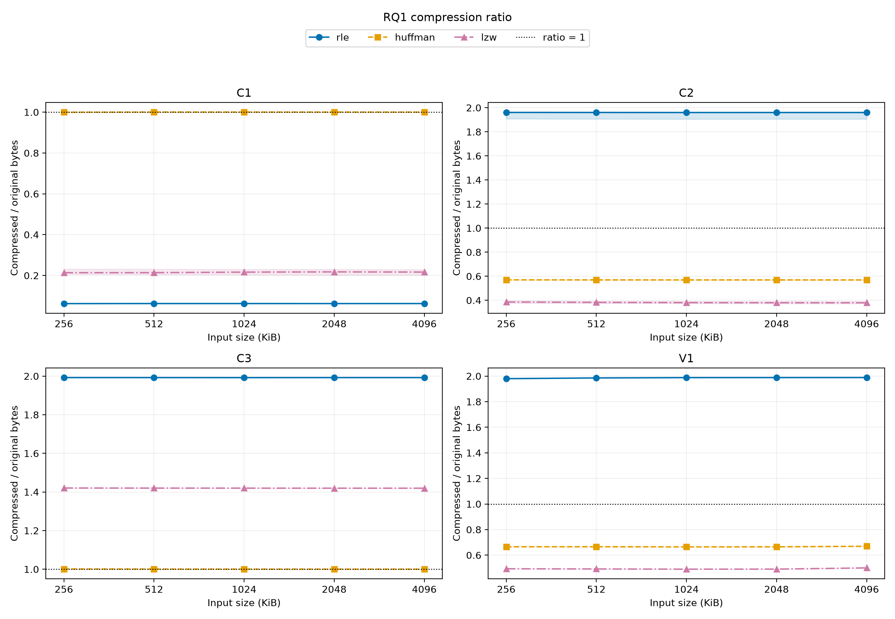
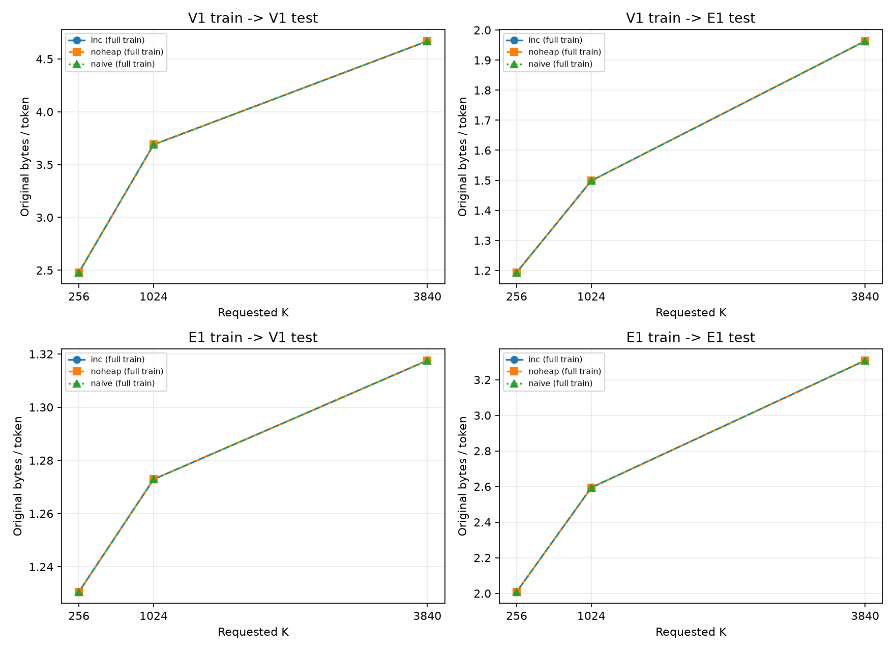
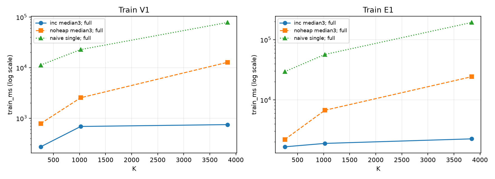

# Khảo sát thực nghiệm các thuật toán nén không mất mát và tokenizer Byte Pair Encoding của mô hình ngôn ngữ lớn

**Nhóm 4 — AI21B — FA26**

**Trần Châu Hoàng Nam — QE210145**

**Nguyễn Trí Viễn — QE210041**

**Phạm Minh Tiến — QE210079**

**Hoàng Đức Khánh — SE180114**

**Trương Đình Tân — QE210065**

**Dương Quốc Thịnh — QE210121**

**Học phần CSD203 — Data Structures and Algorithms with Python · Đề tài 4**

## Tóm tắt

Nghiên cứu đối chiếu RLE, Huffman chính tắc và LZW 12-bit với BPE byte-level trên dữ liệu tổng hợp, Canterbury và Wikipedia Việt–Anh. RQ1 gồm 150 hàng kết quả theo năm kích thước; RQ2 gồm 45 hàng với histogram giữ nguyên; RQ3 gồm 36 hàng BPE và hai baseline LZW. Toàn bộ ma trận RQ3 chính dùng train 1 MiB cho cả ba biến thể. Ở K=3840, BPE huấn luyện cùng ngôn ngữ tạo container nhỏ hơn LZW 32.6% trên V1 và 13.7% trên E1. Trên cùng test V1, tokenizer huấn luyện E1 tạo số token gấp 3.54 lần tokenizer huấn luyện V1. Biến thể gia tăng có heap nhanh hơn naive 17.76–104.72 lần, nhưng naive chỉ có một lần đo cho mỗi cấu hình. Các kết luận mô tả corpus và môi trường đã đo, không suy rộng thành khác biệt tất yếu giữa hai ngôn ngữ.

**Từ khóa—** nén không mất mát; Huffman; LZW; BPE; heap; tokenizer tiếng Việt.

## I. Giới thiệu

RLE khai thác các byte lặp liên tiếp, Huffman xây dựng mã theo tần suất [1], còn LZW học từ điển chuỗi trong khi nén [2]. BPE thay thế cặp ký hiệu thường gặp [3]; việc chuyển sang biểu diễn subword giúp xử lý từ hiếm [4] và là cơ sở của tokenizer byte-level trong GPT-2 [5]. Các thuật toán cùng bảo toàn dữ liệu nhưng khai thác những dạng dư thừa khác nhau.

Ba câu hỏi nghiên cứu là: hiệu quả RLE/Huffman/LZW thay đổi thế nào theo kích thước; hoán vị byte ảnh hưởng tỷ lệ nén thế nào khi entropy bậc 0 không đổi; và BPE so với LZW, giữa ngữ liệu Việt–Anh cũng như giữa ba cấu trúc dữ liệu huấn luyện ra sao. Nghiên cứu tách vai trò codec độc lập, có lưu bảng merge, khỏi vai trò tokenizer chia sẻ bảng đã học.

## II. Phương pháp và khả năng tái lập

### A. Codec và cấu trúc dữ liệu

Mọi container bắt đầu bằng magic bốn byte và độ dài gốc tám byte big-endian. RLE dùng cặp (count, byte), count từ 1 đến 255; run dài được chia nhỏ. Huffman tĩnh hai lượt lưu bảng 256 độ dài mã và dựng mã chính tắc. LZW dùng 4096 mã cố định 12-bit, khóa dict là prefix_code × 256 + byte và đóng băng từ điển khi đầy. Bit Huffman/LZW/BPE được đóng MSB-first, đệm 0 ở byte cuối.

BPE phân đoạn bằng `re.findall(rb" ?[^\s]+|\s+", data)`. Các đoạn trùng nhau được đếm có trọng số tần suất; không gộp qua ranh giới đoạn. Mỗi vòng chọn cặp có tổng số đếm lớn nhất, phá hòa bằng thứ tự từ điển nhỏ nhất, thay từ trái sang phải không chồng lấn. Cặp xuất hiện một lần vẫn hợp lệ; chỉ dừng trước K khi không còn cặp. Encode có cache theo đoạn trong từng lần gọi.

Biến thể naive đếm lại các cặp trên toàn bộ đoạn duy nhất mỗi vòng; noheap cập nhật cục bộ nhờ danh sách liên kết, chỉ mục vị trí và chỉ mục ngược nhưng quét dict để chọn cực đại; inc dùng cùng cập nhật cục bộ và heap (-count, a, b) với xóa lười. Ba biến thể phải sinh cùng danh sách merge trên cùng input/K.

Container BPE gồm BPE1, độ dài gốc, số merge thực m (hai byte), m mục merge ba byte, số token tám byte và payload mã 12-bit. Dung lượng bằng 22 + 3m + ceil(12T/8) byte. Ngân sách tối đa là 256 + 3840 = 4096 token; độ rộng vẫn là 12-bit ở mọi K để đối chiếu LZW.

### B. Ngữ liệu và thiết kế thực nghiệm

C1 có run hình học trung bình 32 byte; C2 có 1000 từ phân bố Zipf s=1 và dấu cách phân tách; C3 là byte ngẫu nhiên đều. Mỗi họ có ba seed 1/2/3 ở 256, 512, 1024, 2048, 4096 KiB. V1 cung cấp một prefix tại mỗi kích thước. RQ1 có 50 input và ba codec, tổng 150 hàng.

V1/E1 lấy từ Wikipedia 20231101.vi/en [6], chuẩn hóa NFC và mã hóa UTF-8. Train là 1 MiB đầu, test là 1 MiB tiếp theo, cắt ở biên ký tự; train V1 thực có 1.048.575 byte, các test có 1.048.576 byte. Manifest ghi kích thước và SHA-256. RQ2 dùng alice29.txt, kennedy.xls của Canterbury [7] và test V1; ba trạng thái là gốc, counting sort theo byte và Fisher–Yates với ba seed. Trạng thái shuffled được tổng hợp theo trung bình ba seed.

RQ3 dùng mọi cặp train/test V1/E1, K=256/1024/3840 và cả ba biến thể. CSV chính hiện dùng full train ở mọi cấu hình. Bốn timing naive K cao đã đo trên full corpus được nhập từ hồ sơ bổ sung sau khi đối chiếu hash input/merge; tám hàng encode/decode liên quan được đo lại. Dữ liệu prefix cũ được lưu riêng và không dùng trong bảng hoặc đường biểu diễn chính.

### C. Chỉ số và quy trình đo

Tỷ lệ codec là comp_bytes/orig_bytes; BPE token-only là ceil(12T/8)/orig_bytes; byte/token là orig_bytes/T. Tỷ lệ càng nhỏ càng tốt, byte/token càng lớn càng ít token trên cùng số byte. Thông lượng bằng orig_bytes/1024 chia thời gian giây. Entropy H₀ = −Σ pᵢ log₂ pᵢ, và H₀/8 là mốc byte nén/byte gốc.

Thời gian nén/giải nén lấy trung vị ba lượt time.perf_counter. Training đo riêng: inc/noheap trung vị ba lượt, naive một lượt; hai test dùng lại một model nên không được tính thành hai lần train độc lập. Bộ nhớ là đỉnh cấp phát Python qua tracemalloc trong lượt riêng, không phải toàn bộ RAM tiến trình. Bộ nhớ train bổ sung chỉ đo prefix 128 KiB, K=256, một lượt mỗi biến thể/ngôn ngữ; không thay cho thí nghiệm train 1 MiB.

Mỗi lượt timing và lượt memory của pipeline hiện tại đối chiếu SHA-256 đầy đủ sau giải nén; output_check lưu 16 ký tự hex đầu. Decoder từ chối magic sai; LZW kiểm tra padding, Huffman kiểm tra bảng mã vượt khả năng biểu diễn, dữ liệu thừa và padding, BPE kiểm tra bảng merge, ID, độ dài và padding.

Máy thu RQ1 được người thực hiện ghi nhận là Intel Core i7-13650HX, RAM 24 GB, Windows 11, Python 3.13.2. RQ1/RQ2 là số đo đã thu trước đợt gia cố decoder; không được trình bày là timing mới của phiên bản vừa sửa. Các phép đo RQ3 bổ sung diễn ra ở phiên khác, nên sai khác tải máy vẫn là yếu tố gây nhiễu. Hồ sơ kiểm chứng và mã nguồn đi kèm cho phép tái lập các phép tính từ CSV.

## III. Kết quả RQ1: loại dữ liệu và quy mô

Bảng I trình bày trung vị ba seed tổng hợp ở cỡ 4096 KiB; V1 chỉ có một mẫu. RLE tốt nhất trên run dài; LZW tốt nhất trên C2 và V1; trên C3 cả ba không nén được đáng kể và overhead làm file phình ra.

*Bảng I. Tỷ lệ nén tại 4096 KiB danh nghĩa; nguồn rq1/out/rq1_ratio.csv.*

| Họ | RLE | Huffman | LZW |
| --- | --- | --- | --- |
| C1 | 0.062526 | 1.000064 | 0.216611 |
| C2 | 1.960098 | 0.569210 | 0.379549 |
| C3 | 1.992249 | 1.000064 | 1.419488 |
| V1 | 1.988627 | 0.669362 | 0.500129 |

*Hình 1. Tỷ lệ nén ở đủ năm kích thước; dải biểu diễn min–max qua seed.*

Tăng kích thước làm giảm tỷ trọng header nhưng không tự tạo cấu trúc dễ nén. C1 có nhiều run dù histogram byte gần đều: RLE nén tốt trong khi Huffman gần tỷ lệ 1. C2 lặp từ, tạo cơ hội tái dùng chuỗi trong LZW. C3 gần đều và ít cấu trúc, kiểm chứng rằng codec không thể luôn giảm dung lượng.

*Bảng II. Thông lượng nén/giải nén và bộ nhớ đỉnh ở 4096 KiB; trung vị theo seed, V1 một mẫu.*

| Họ | Codec | Nén KiB/s | Giải nén KiB/s | Đỉnh KiB |
| --- | --- | --- | --- | --- |
| C1 | rle | 29,495.6 | 140,597.5 | 8,629.3 |
| C1 | huffman | 5,724.7 | 1,811.2 | 275,579.5 |
| C1 | lzw | 12,541.4 | 34,385.2 | 9,570.1 |
| C2 | rle | 8,602.6 | 7,093.1 | 16,628.0 |
| C2 | huffman | 7,521.5 | 2,783.3 | 156,365.0 |
| C2 | lzw | 10,588.9 | 20,581.5 | 10,070.7 |
| C3 | rle | 8,603.0 | 7,070.2 | 17,265.7 |
| C3 | huffman | 5,687.9 | 1,617.3 | 275,579.5 |
| C3 | lzw | 7,350.1 | 5,927.0 | 14,571.9 |
| V1 | rle | 8,845.6 | 7,089.0 | 17,250.9 |
| V1 | huffman | 6,892.0 | 2,420.7 | 185,566.6 |
| V1 | lzw | 9,577.2 | 15,614.5 | 10,426.7 |

*Hình 2. Thông lượng nén và giải nén theo quy mô dữ liệu.*

*Hình 3. Đỉnh cấp phát trong lượt compress/decompress riêng.*

Thông lượng không tăng đơn điệu theo kích thước vì chi phí thuật toán, cấu trúc input và tải hệ thống cùng tác động. Huffman hiện tạo chuỗi bit Python trung gian nên bộ nhớ tăng mạnh theo input; đây là đặc điểm cài đặt, không phải yêu cầu tất yếu của thuật toán. Sáu ô timing được đánh dấu trong ba hàng RQ1 vẫn được giữ, không chọn giá trị nhỏ nhất để làm đẹp kết quả.

## IV. Kết quả RQ2: giữ histogram, đổi thứ tự

*Bảng III. Tỷ lệ nén và H₀/8; shuffled là trung bình ba seed. Nguồn results_rq2_all.csv.*

| Tệp | Trạng thái | H₀/8 | RLE | Huffman | LZW |
| --- | --- | --- | --- | --- | --- |
| alice29.txt | original | 0.570960 | 1.905880 | 0.578319 | 0.475577 |
| alice29.txt | runs | 0.570960 | 0.008469 | 0.578319 | 0.032645 |
| alice29.txt | shuffled | 0.570960 | 1.862670 | 0.578319 | 0.686418 |
| kennedy.xls | original | 0.446684 | 1.681770 | 0.449432 | 0.407137 |
| kennedy.xls | runs | 0.446684 | 0.008167 | 0.449432 | 0.212572 |
| kennedy.xls | shuffled | 0.446684 | 1.525510 | 0.449432 | 0.544609 |
| v1_test_1mib.txt | original | 0.660910 | 1.988550 | 0.665004 | 0.492817 |
| v1_test_1mib.txt | runs | 0.660910 | 0.008083 | 0.665004 | 1.044570 |
| v1_test_1mib.txt | shuffled | 0.660910 | 1.894910 | 0.665004 | 0.820334 |

*Hình 4. Ảnh hưởng thứ tự byte tới ba codec.*

Huffman giữ nguyên kích thước nén tuyệt đối qua các hoán vị của từng input, vì tần suất byte và độ dài mã không đổi. RLE cải thiện rất mạnh khi counting sort gom byte thành run; xáo trộn phá các run này. LZW thường nén kém đi sau xáo trộn vì quan hệ chuỗi con bị phá, dù histogram giữ nguyên.

Trường hợp V1-runs là ngoại lệ đáng chú ý: LZW có tỷ lệ 1.044570, lớn hơn 1 và kém dữ liệu gốc. Log cơ chế cho thấy dictionary đầy tại byte 319103, khoảng 30% input, sau đó bị đóng băng; trên alice29-runs dictionary không đầy. Quan sát này phù hợp với giới hạn thích nghi sau khi đầy, nhưng chưa có đối chứng đổi chính sách dictionary nên không chứng minh một nguyên nhân duy nhất.

H₀ bất biến theo hoán vị và Huffman vẫn cao hơn H₀/8 khi bỏ header trên ba tệp. LZW có thể thấp hơn H₀/8 vì khai thác phụ thuộc chuỗi, trong khi H₀ chỉ mô tả tần suất biên từng byte. Vì vậy H₀/8 không phải cận dưới tuyệt đối cho mọi codec có ngữ cảnh.

## V. Kết quả RQ3: codec, tokenizer và huấn luyện

### A. Hai tỷ lệ BPE và baseline LZW

Bảng IV dùng inc trên full train; mọi biến thể còn lại cho cùng merge, token count và kích thước nén khi input/K giống nhau. LZW dùng cùng test và giới hạn mã 12-bit; baseline không phụ thuộc ngôn ngữ train. Mỗi hàng trình bày cả tỷ lệ codec độc lập và token-only theo đúng hai cách sử dụng BPE.

*Bảng IV. Tỷ lệ BPE gồm overhead, chỉ payload và LZW trên cùng test; nhỏ hơn là tốt hơn.*

| K | Train → test | BPE codec | BPE token-only | LZW |
| --- | --- | --- | --- | --- |
| 256 | V1 → V1 | 0.605747 | 0.604994 | 0.492817 |
| 256 | V1 → E1 | 1.257490 | 1.256730 | 0.538014 |
| 256 | E1 → V1 | 1.219690 | 1.218940 | 0.492817 |
| 256 | E1 → E1 | 0.747497 | 0.746743 | 0.538014 |
| 1024 | V1 → V1 | 0.409581 | 0.406631 | 0.492817 |
| 1024 | V1 → E1 | 1.003790 | 1.000840 | 0.538014 |
| 1024 | E1 → V1 | 1.181380 | 1.178430 | 0.492817 |
| 1024 | E1 → E1 | 0.581138 | 0.578187 | 0.538014 |
| 3840 | V1 → V1 | 0.332326 | 0.321319 | 0.492817 |
| 3840 | V1 → E1 | 0.775084 | 0.764076 | 0.538014 |
| 3840 | E1 → V1 | 1.149490 | 1.138480 | 0.492817 |
| 3840 | E1 → E1 | 0.464467 | 0.453460 | 0.538014 |

Ở K=256, BPE cùng ngôn ngữ còn kém LZW trên cả hai corpus; khi tăng K, khả năng ghép đoạn giúp giảm token count. Tại K=3840, BPE cùng ngôn ngữ nhỏ hơn LZW 32.6% trên V1 và 13.7% trên E1, đã tính cả overhead. Lợi ích không bảo đảm khi đổi ngôn ngữ: tokenizer E1 trên test V1 có tỷ lệ codec 1.149490, tức file phình ra.

Overhead BPE bằng 22 + 3m byte; ở m=3840 là 11542 byte. Khoảng cách hai tỷ lệ là overhead/orig_bytes, không chỉ riêng bảng merge. Token-only giả định bên sử dụng đã có bảng merge; không thể gọi đó là dung lượng của một file tự giải mã độc lập. LZW không truyền bảng học sẵn mà đồng bộ dictionary qua luồng, nên cùng độ rộng mã không có nghĩa hai định dạng có cùng overhead.

### B. Ma trận tokenizer Việt–Anh 2×2

*Bảng V. inc, K=3840: mỗi ô ghi byte/token / số token trên test 1 MiB.*

| Train | Test V1 | Test E1 |
| --- | --- | --- |
| V1 | 4.66826 / 224,618 | 1.96315 / 534,128 |
| E1 | 1.31755 / 795,855 | 3.30790 / 316,991 |

*Hình 5. Byte/token ở đủ ba K; các biến thể trùng nhau do cùng merge trên cùng input.*

Trên test V1, bảng học từ E1 tạo 3.54 lần số token của bảng học từ V1. Trên test E1, bảng học từ V1 tạo 1.68 lần số token của bảng học từ E1. Đây là phép so sánh giữ nguyên test nên trực tiếp mô tả thiệt hại do đổi ngữ liệu huấn luyện trong hai corpus này. Khi tính phí hoặc ngân sách ngữ cảnh theo token, nhiều token hơn cho cùng nội dung làm tăng chi phí và chiếm nhiều vị trí ngữ cảnh hơn; không có giá API cụ thể được đo ở đây.

Byte-level khởi đầu từ từng byte UTF-8. Chữ có dấu tiếng Việt có thể cần nhiều byte, và bảng học chủ yếu trên tiếng Anh có thể thiếu các merge hữu ích cho tiếng Việt. Cơ chế này phù hợp với chênh lệch train E1 → test V1 đã thấy, nhưng chưa có profiling tần suất để tách riêng từng nguyên nhân. Byte/token không phải ký tự/token. Khi mỗi tokenizer học đúng ngôn ngữ của mình, V1 trong thí nghiệm còn có byte/token cao hơn E1; vì corpus không song song, không thể kết luận tiếng Việt luôn tốn nhiều token hơn tiếng Anh cho cùng ý nghĩa.

### C. Độ phức tạp và tăng tốc thực tế

Gọi N là độ dài input, U là tổng độ dài các đoạn duy nhất ban đầu, Pₜ là số cặp còn hoạt động ở vòng t, Aₜ là số vị trí bị ảnh hưởng, H là kích thước heap và R là tổng số entry được đưa vào heap. Tất cả cách train đều cần quét input để phân đoạn và tính trọng số.

Naive đếm lại và thay thế trên mọi đoạn duy nhất mỗi vòng, có cận trên O(N + KU), bộ nhớ O(U + Pₜ). Noheap duy trì liên kết và chỉ mục để chỉ cập nhật các cạnh bị ảnh hưởng, nhưng chọn cặp tốn O(Pₜ) mỗi vòng. Sắp vị trí và các segment bị ảnh hưởng để giữ thứ tự có thể thêm O(Aₜ log Aₜ); tổng chi phí còn phụ thuộc số lần cập nhật cạnh.

Inc thay quét chọn cực đại bằng heap. Push/pop tốn O(log H), phần heap tổng quát là O(R log H); lazy deletion có thể giữ entry cũ cho đến khi pop. Inc vẫn trả chi phí cập nhật chỉ mục và sắp các vị trí bị ảnh hưởng. Vì số cặp, độ dài đoạn và số entry stale biến đổi, không nên mô tả toàn bộ trainer chỉ bằng O(K log P) hoặc khẳng định tăng tốc luôn cố định.

*Bảng VI. Train full corpus; naive một lượt, noheap/inc trung vị ba lượt. Speedup là thời gian biến thể chia thời gian inc.*

| Train | K | Naive ms | Noheap ms | Inc ms | Naive/inc | Noheap/inc |
| --- | --- | --- | --- | --- | --- | --- |
| V1 | 256 | 11,265.3 | 784.8 | 272.1 | 41.40× | 2.88× |
| V1 | 1024 | 22,819.3 | 2,542.6 | 687.3 | 33.20× | 3.70× |
| V1 | 3840 | 78,275.2 | 12,748.9 | 747.5 | 104.72× | 17.06× |
| E1 | 256 | 29,447.5 | 2,195.8 | 1,657.9 | 17.76× | 1.32× |
| E1 | 1024 | 56,807.8 | 6,712.4 | 1,888.0 | 30.09× | 3.56× |
| E1 | 3840 | 193,328.0 | 24,234.9 | 2,247.5 | 86.02× | 10.78× |

*Hình 6. Thời gian train với cùng input 1 MiB ở mọi điểm; trục thời gian logarit.*

Inc nhanh hơn noheap 1.32–17.06 lần và nhanh hơn naive 17.76–104.72 lần trong các cấu hình đã đo. Dùng cùng input và merge loại bỏ sai lệch do so train 128 KiB với 1 MiB. Tuy nhiên, naive chỉ có một lượt, các phiên đo khác nhau và không có khoảng tin cậy; các tỷ số là kết quả quan sát chứ không phải cam kết hiệu năng phổ quát.

*Hình 7. Thí nghiệm bộ nhớ train riêng: prefix 128 KiB, K=256, một lượt tracing; không phải RAM train 1 MiB.*

## VI. Kiểm thử, thảo luận và giới hạn

Bộ kiểm thử gồm input rỗng, một byte, 64 KiB cùng byte, đủ 256 giá trị byte, ABABABA và aaabdaaabac với K=3. Ví dụ cuối cho merge (97,97), (97,98), (256,257), token [258,100,258,97,99] và container 39 byte. Các oracle độc lập kiểm tra biểu diễn bit, phân đoạn, thứ tự merge và sự tương đương ba trainer; kiểm thử ngẫu nhiên bổ sung các trường hợp chồng lấn và ranh giới đoạn.

Hồi quy bổ sung xác nhận lượt memory phải báo lỗi nếu chỉ lượt đó giải nén sai, và phải tắt tracemalloc khi codec ném exception. Decoder được kiểm tra với padding khác 0, payload thừa, header cắt cụt và bảng Huffman vượt khả năng biểu diễn. Các kiểm chứng dữ liệu kiểm tra ma trận, hash, phép tính metric và truy vết thời gian tới audit; báo cáo này sinh bảng trực tiếp từ CSV để hạn chế lỗi chép số và đơn vị.

RQ1 có một mẫu V1 mỗi cỡ, nên không suy ra biến thiên giữa nhiều văn bản tiếng Việt. Dải seed của dữ liệu tổng hợp là khác biệt input, không phải khoảng tin cậy của cùng một input. RQ2 chỉ có ba tệp và thiếu timing thô từng lượt trong CSV. Số liệu RQ1/RQ2 lịch sử được giữ nguyên; các sửa kiểm tra lỗi không biến chúng thành phép đo mới.

RQ3 dùng corpus không song song, nên ngôn ngữ bị trộn với chủ đề và phân bố nội dung. Training memory chỉ trên prefix, và naive chỉ đo một lần. Việc dùng bảng merge học sẵn làm BPE khác LZW về chi phí chuẩn bị dù cùng số mã; train_ms luôn được tách khỏi encode/decode. Bộ nhớ tracemalloc phản ánh cấp phát Python trong phạm vi đo, không phản ánh toàn bộ footprint hệ thống.

## VII. Kết luận

RLE phù hợp dữ liệu run dài, Huffman ổn định khi giữ histogram, còn LZW khai thác chuỗi con và nhạy với thứ tự byte. BPE full-corpus ở K cao có thể nén tốt hơn LZW khi train/test cùng ngôn ngữ, nhưng không bảo đảm tốt khi chuyển corpus. Bảng 2×2 cho thấy chi phí token tăng rõ khi áp tokenizer học từ E1 lên V1, trong khi không đủ bằng chứng để khẳng định tiếng Việt luôn bất lợi trên mọi tokenizer. Cập nhật gia tăng và heap giảm thời gian train trong các cấu hình đã đo. Hướng tiếp theo là đo lặp naive, đo RAM full-corpus, dùng văn bản song song và tối ưu biểu diễn bit Huffman.

## Tài liệu tham khảo

[1] D. A. Huffman, “A method for the construction of minimum-redundancy codes,” Proceedings of the IRE, vol. 40, no. 9, pp. 1098–1101, 1952.

[2] T. A. Welch, “A technique for high-performance data compression,” Computer, vol. 17, no. 6, pp. 8–19, 1984.

[3] P. Gage, “A new algorithm for data compression,” The C Users Journal, vol. 12, no. 2, pp. 23–38, 1994.

[4] R. Sennrich, B. Haddow, and A. Birch, “Neural machine translation of rare words with subword units,” in Proc. 54th Annual Meeting of the Association for Computational Linguistics, pp. 1715–1725, 2016.

[5] A. Radford et al., “Language models are unsupervised multitask learners,” OpenAI Technical Report, 2019.

[6] Wikimedia Foundation, “wikimedia/wikipedia,” Hugging Face Datasets, configurations 20231101.vi and 20231101.en. [Online]. Available: https://huggingface.co/datasets/wikimedia/wikipedia.

[7] R. Arnold and T. Bell, “A corpus for the evaluation of lossless compression algorithms,” in Proc. Data Compression Conference, pp. 201–210, 1997.

## Phụ lục: nguồn dữ liệu và tái lập

RQ1: results/results_rq1.csv và rq1/out/; RQ2: results_rq2_all.csv và rq2/out/; RQ3: results/results_rq3.csv, rq3/out/rq3_run_audit.json và final_submission/naive_full_experiment.json. Hồ sơ mixed-scope cũ nằm riêng trong results/archive/mixed_scope/.

Chạy python -m pytest -q để kiểm thử; python -m rq1.verify_rq1_report, python -m rq2.check_results, python -m rq2.verify_report và python -m rq3.check_results_rq3 để đối chiếu số liệu. Chạy python -m rq3.analyze_rq3 để tái tạo bảng/hình RQ3, python -m final_submission.generate_report để sinh báo cáo Markdown và python -m final_submission.build_submission để xuất DOCX/HTML. Các tùy chọn --check của bộ sinh nội dung và phân tích kiểm tra sự khớp với nguồn mà không ghi đè kết quả đo.

Danh sách file và SHA-256 nguồn nằm trong report_sources.json; kết quả xác minh của phiên sửa nằm trong validation_report.md. Dữ liệu gốc không được phân phối qua Git; cần phục hồi đúng manifest theo README trước khi chạy thí nghiệm corpus.
