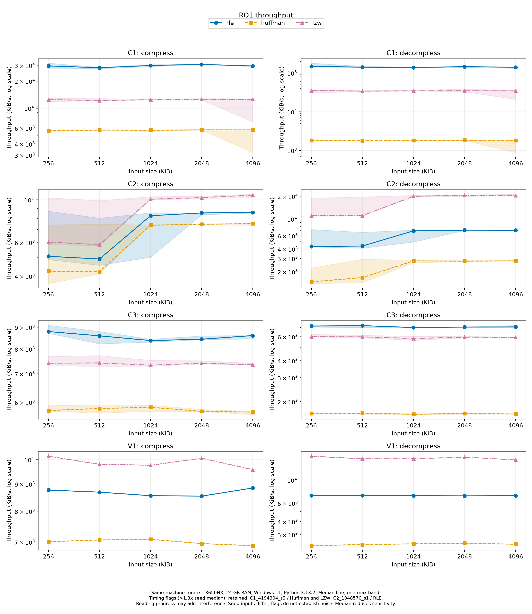
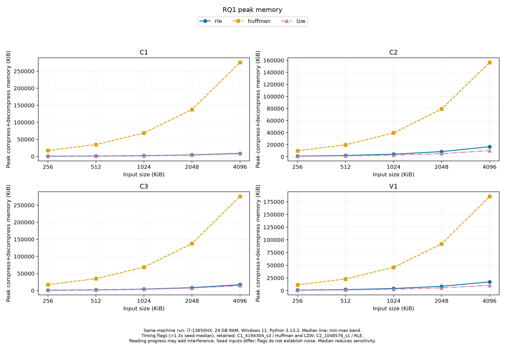

# RQ1 Report Draft: Lossless Compression Benchmark on Synthetic and Natural Text Data

## Method

This study evaluates three lossless data compression codecs—Run-Length Encoding (RLE), canonical Huffman coding, and Lempel-Ziv-Welch (LZW)—across systematic synthetic byte sequences and natural language text across five input scales.

### Data Corpora

The benchmark matrix comprises 50 distinct files across four dataset families:

1. **C1 (Long runs)**: Synthetic byte streams generated via `gen_synthetic.py` where run lengths follow a geometric distribution with mean run length $\mu = 32$ (parameter $p = 1/32$). Adjacent runs are strictly constrained to have distinct byte values chosen uniformly from 0 to 255. Evaluated at five nominal sizes: 256, 512, 1024, 2048, and 4096 KiB (exact byte counts: 262,144; 524,288; 1,048,576; 2,097,152; and 4,194,304 bytes), each generated with three deterministic random seeds (1, 2, 3), totaling 15 files.
2. **C2 (Zipf word distribution)**: Synthetic text generated via `gen_synthetic.py` using a vocabulary of 1,000 distinct words (word lengths uniformly distributed between 2 and 9 lowercase ASCII letters), drawn according to Zipf's law ($s = 1$), separated by single ASCII space characters. Evaluated at the same five nominal sizes (256, 512, 1024, 2048, 4096 KiB) across three random seeds (1, 2, 3), totaling 15 files.
3. **C3 (Uniform random bytes)**: Uncorrelated random byte streams generated via `random.Random(f"C3-{seed}").randbytes(size)` in `gen_synthetic.py`, establishing an incompressible baseline with empirical entropy $H_0 \approx 8$ bits/byte. Evaluated at the five nominal sizes across three random seeds (1, 2, 3), totaling 15 files.
4. **V1 (Vietnamese Wikipedia text)**: Natural language text extracted from `wikimedia/wikipedia 20231101.vi` via `tools/prepare_wiki.py`, normalized to Unicode NFC and encoded in UTF-8. Slicing into the five nominal sizes (256, 512, 1024, 2048, 4096 KiB) is performed strictly at UTF-8 character boundaries. Consequently, files never split multibyte characters; actual byte counts are 262,144 bytes (256 KiB), 524,288 bytes (512 KiB), 1,048,575 bytes (1024 KiB), 2,097,152 bytes (2048 KiB), and 4,194,303 bytes (4096 KiB). V1 is a single continuous sequence without random seeds ($n = 1$ sample per size), totaling 5 files.

### Codecs and Container Specifications

All codecs process input bytes and produce encapsulated binary outputs complying with the project container specification:

- **RLE (`rle.py`)**: Byte-pair run-length encoding. Run counts are capped at 255. Each run is serialized as a count byte followed by the literal byte value. Encapsulated with a 12-byte container header consisting of the 4-byte ASCII magic `RLE1` and an 8-byte big-endian unsigned integer indicating original byte length.
- **Canonical Huffman (`rq2/huffman.py`, exposed via `huffman.py`)**: Pure-Python canonical prefix-free coding. Code lengths for all 256 possible byte values are constructed from symbol frequency histograms. Serialized with a 268-byte header: 4-byte ASCII magic `HUF1`, 8-byte big-endian original length, and 256 bytes recording symbol code lengths (0 to 255), followed by MSB-packed canonical codewords with zero-bit padding to the byte boundary.
- **LZW (`lzw.py`)**: Lempel-Ziv-Welch dictionary compression using fixed 12-bit code words (maximum vocabulary size of 4,096 symbols: 256 initial single-byte literals, up to 3,840 dynamically learned multi-byte phrases). Codes are packed into bytes MSB-first. Encapsulated with a 12-byte container header consisting of 4-byte ASCII magic `LZW1` and an 8-byte big-endian original length.

Each codec is executed on all 50 files, yielding $50 \times 3 = 150$ experimental rows recorded in `results/results_rq1.csv`.

### Measurement Protocol

- **Execution and Timing**: Benchmarks were run using `run_rq1.py`. For each file and codec, compression elapsed time (`comp_ms`) and decompression elapsed time (`decomp_ms`) were measured using `time.perf_counter` across three untraced repetitions; the recorded metric is the median of these three runs.
- **Peak Memory**: Memory allocation peak (`peak_mem_kib`) was measured using Python's standard `tracemalloc` module during a dedicated, separate execution pass covering both compression and decompression. Tracing was conducted in a separate pass to ensure `tracemalloc` instrumentation overhead does not distort untraced timing measurements.
- **Data Integrity**: Every row underwent round-trip integrity validation (`roundtrip_ok = True`). The decompressed byte string was verified against the original byte sequence via full SHA-256 calculation; the first 16 hexadecimal characters of the SHA-256 hash are recorded in `output_check`.
- **Metrics**:
  - Compression ratio: $\text{ratio} = \text{comp\_bytes} / \text{orig\_bytes}$ (dimensionless; includes all container and codec headers; smaller values indicate superior compression).
  - Compression throughput: $\text{comp\_kibs} = (\text{orig\_bytes} / 1024) / (\text{comp\_ms} / 1000)$ (KiB/s).
  - Decompression throughput: $\text{decomp\_kibs} = (\text{orig\_bytes} / 1024) / (\text{decomp\_ms} / 1000)$ (KiB/s).
  - Peak memory: $\text{peak\_mem\_kib}$ (KiB).
- **Execution Platform**: All 150 experimental rows were measured in a single batch on the same physical host: Intel Core i7-13650HX, 24 GB RAM, Windows 11, Python 3.13.2 (owner-reported total execution wall time: 1160.0407191 seconds).

## Results

Quantitative summaries are presented in the three tables below, extracted from `rq1/out/rq1_ratio.csv`, `rq1/out/rq1_throughput.csv`, and `rq1/out/rq1_memory.csv`. For C1, C2, and C3, reported statistics are the median, minimum, and maximum across seeds 1–3 ($n = 3$); for V1, values represent the single observed sequence ($n = 1$). All numerical values use 12 significant digits (standard Python `format(value, '.12g')`), matching `rq1/analyze_rq1.py`.

The three summary tables contain 1,620 total table cells across 60 rows, of which 1,080 are quantitative numerical measurement cells (size, sample count, and measured ratio, throughput, and memory statistics) and 540 are descriptive categorical metadata cells (`dataset`, `codec`, `source_csv_lines`).

### Compression Ratio

<!-- BEGIN:ratio -->
| dataset | size_kib | codec | n_samples | source_csv_lines | ratio_median | ratio_min | ratio_max |
| --- | --- | --- | --- | --- | --- | --- | --- |
| C1 | 256 | rle | 3 | 2,5,8 | 0.062256 | 0.061806 | 0.063721 |
| C1 | 256 | huffman | 3 | 3,6,9 | 0.99939 | 0.998833 | 0.999409 |
| C1 | 256 | lzw | 3 | 4,7,10 | 0.213623 | 0.206242 | 0.231457 |
| C1 | 512 | rle | 3 | 11,14,17 | 0.062569 | 0.062298 | 0.063404 |
| C1 | 512 | huffman | 3 | 12,15,18 | 1.000263 | 1.000179 | 1.000351 |
| C1 | 512 | lzw | 3 | 13,16,19 | 0.213842 | 0.204967 | 0.231306 |
| C1 | 1024 | rle | 3 | 20,23,26 | 0.062531 | 0.062117 | 0.063133 |
| C1 | 1024 | huffman | 3 | 21,24,27 | 1.000252 | 1.000236 | 1.000256 |
| C1 | 1024 | lzw | 3 | 22,25,28 | 0.216407 | 0.203942 | 0.230304 |
| C1 | 2048 | rle | 3 | 29,32,35 | 0.062427 | 0.062421 | 0.062808 |
| C1 | 2048 | huffman | 3 | 30,33,36 | 1.000128 | 1.000128 | 1.000128 |
| C1 | 2048 | lzw | 3 | 31,34,37 | 0.217624 | 0.201663 | 0.230362 |
| C1 | 4096 | rle | 3 | 38,41,44 | 0.062526 | 0.062498 | 0.062615 |
| C1 | 4096 | huffman | 3 | 39,42,45 | 1.000064 | 1.000064 | 1.000064 |
| C1 | 4096 | lzw | 3 | 40,43,46 | 0.216611 | 0.201882 | 0.228684 |
| C2 | 256 | rle | 3 | 47,50,53 | 1.960785 | 1.90786 | 1.963921 |
| C2 | 256 | huffman | 3 | 48,51,54 | 0.569988 | 0.567825 | 0.570259 |
| C2 | 256 | lzw | 3 | 49,52,55 | 0.385986 | 0.376404 | 0.395561 |
| C2 | 512 | rle | 3 | 56,59,62 | 1.960598 | 1.906517 | 1.963474 |
| C2 | 512 | huffman | 3 | 57,60,63 | 0.569593 | 0.567223 | 0.569956 |
| C2 | 512 | lzw | 3 | 58,61,64 | 0.382988 | 0.37429 | 0.392336 |
| C2 | 1024 | rle | 3 | 65,68,71 | 1.960033 | 1.905611 | 1.963449 |
| C2 | 1024 | huffman | 3 | 66,69,72 | 0.569331 | 0.567076 | 0.569817 |
| C2 | 1024 | lzw | 3 | 67,70,73 | 0.38083 | 0.373311 | 0.391779 |
| C2 | 2048 | rle | 3 | 74,77,80 | 1.960211 | 1.905438 | 1.96385 |
| C2 | 2048 | huffman | 3 | 75,78,81 | 0.569274 | 0.566845 | 0.569647 |
| C2 | 2048 | lzw | 3 | 76,79,82 | 0.379856 | 0.371984 | 0.391164 |
| C2 | 4096 | rle | 3 | 83,86,89 | 1.960098 | 1.905555 | 1.963778 |
| C2 | 4096 | huffman | 3 | 84,87,90 | 0.56921 | 0.566659 | 0.569599 |
| C2 | 4096 | lzw | 3 | 85,88,91 | 0.379549 | 0.37181 | 0.390563 |
| C3 | 256 | rle | 3 | 92,95,98 | 1.992378 | 1.991875 | 1.992577 |
| C3 | 256 | huffman | 3 | 93,96,99 | 1.001022 | 1.001022 | 1.001022 |
| C3 | 256 | lzw | 3 | 94,97,100 | 1.420395 | 1.41996 | 1.420704 |
| C3 | 512 | rle | 3 | 101,104,107 | 1.992283 | 1.991879 | 1.992496 |
| C3 | 512 | huffman | 3 | 102,105,108 | 1.000511 | 1.000511 | 1.000511 |
| C3 | 512 | lzw | 3 | 103,106,109 | 1.419964 | 1.419054 | 1.420635 |
| C3 | 1024 | rle | 3 | 110,113,116 | 1.992104 | 1.991985 | 1.992414 |
| C3 | 1024 | huffman | 3 | 111,114,117 | 1.000256 | 1.000256 | 1.000256 |
| C3 | 1024 | lzw | 3 | 112,115,118 | 1.419777 | 1.419347 | 1.420008 |
| C3 | 2048 | rle | 3 | 119,122,125 | 1.992282 | 1.992001 | 1.992446 |
| C3 | 2048 | huffman | 3 | 120,123,126 | 1.000128 | 1.000128 | 1.000128 |
| C3 | 2048 | lzw | 3 | 121,124,127 | 1.419535 | 1.419194 | 1.419768 |
| C3 | 4096 | rle | 3 | 128,131,134 | 1.992249 | 1.992156 | 1.992262 |
| C3 | 4096 | huffman | 3 | 129,132,135 | 1.000064 | 1.000064 | 1.000064 |
| C3 | 4096 | lzw | 3 | 130,133,136 | 1.419488 | 1.419439 | 1.419827 |
| V1 | 256 | rle | 1 | 137 | 1.979866 | 1.979866 | 1.979866 |
| V1 | 256 | huffman | 1 | 138 | 0.665276 | 0.665276 | 0.665276 |
| V1 | 256 | lzw | 1 | 139 | 0.493378 | 0.493378 | 0.493378 |
| V1 | 512 | rle | 1 | 140 | 1.985561 | 1.985561 | 1.985561 |
| V1 | 512 | huffman | 1 | 141 | 0.665476 | 0.665476 | 0.665476 |
| V1 | 512 | lzw | 1 | 142 | 0.49198 | 0.49198 | 0.49198 |
| V1 | 1024 | rle | 1 | 143 | 1.98806 | 1.98806 | 1.98806 |
| V1 | 1024 | huffman | 1 | 144 | 0.664569 | 0.664569 | 0.664569 |
| V1 | 1024 | lzw | 1 | 145 | 0.490157 | 0.490157 | 0.490157 |
| V1 | 2048 | rle | 1 | 146 | 1.988297 | 1.988297 | 1.988297 |
| V1 | 2048 | huffman | 1 | 147 | 0.664891 | 0.664891 | 0.664891 |
| V1 | 2048 | lzw | 1 | 148 | 0.49061 | 0.49061 | 0.49061 |
| V1 | 4096 | rle | 1 | 149 | 1.988627 | 1.988627 | 1.988627 |
| V1 | 4096 | huffman | 1 | 150 | 0.669362 | 0.669362 | 0.669362 |
| V1 | 4096 | lzw | 1 | 151 | 0.500129 | 0.500129 | 0.500129 |
<!-- END:ratio -->

### Throughput

<!-- BEGIN:throughput -->
| dataset | size_kib | codec | n_samples | source_csv_lines | comp_kibs_median | comp_kibs_min | comp_kibs_max | decomp_kibs_median | decomp_kibs_min | decomp_kibs_max |
| --- | --- | --- | --- | --- | --- | --- | --- | --- | --- | --- | --- |
| C1 | 256 | rle | 3 | 2,5,8 | 29577.594974 | 27925.038725 | 31754.301124 | 149427.97047 | 148233.932077 | 179876.335554 |
| C1 | 256 | huffman | 3 | 3,6,9 | 5587.884766 | 5536.296261 | 5622.530534 | 1811.403208 | 1769.617873 | 1849.493159 |
| C1 | 256 | lzw | 3 | 4,7,10 | 12432.857709 | 11839.080994 | 12931.90543 | 35101.190131 | 30506.697172 | 36039.079881 |
| C1 | 512 | rle | 3 | 11,14,17 | 28240.173856 | 27600.631802 | 28556.927015 | 141463.819056 | 134843.296909 | 149523.976555 |
| C1 | 512 | huffman | 3 | 12,15,18 | 5715.421144 | 5635.898915 | 5752.867164 | 1756.860161 | 1741.506669 | 1758.505051 |
| C1 | 512 | lzw | 3 | 13,16,19 | 12188.386753 | 12155.74549 | 12804.70573 | 34031.692033 | 33393.119193 | 36016.516966 |
| C1 | 1024 | rle | 3 | 20,23,26 | 29889.781436 | 29132.124428 | 30563.606036 | 138565.62925 | 134841.52178 | 141743.836711 |
| C1 | 1024 | huffman | 3 | 21,24,27 | 5676.02009 | 5519.32302 | 5713.612962 | 1810.746889 | 1763.100578 | 1810.911484 |
| C1 | 1024 | lzw | 3 | 22,25,28 | 12415.672847 | 12344.711605 | 12545.821655 | 34479.855882 | 34130.261604 | 35584.962581 |
| C1 | 2048 | rle | 3 | 29,32,35 | 30770.756364 | 30663.135216 | 30863.639378 | 146095.789726 | 139728.457464 | 148176.016864 |
| C1 | 2048 | huffman | 3 | 30,33,36 | 5732.765245 | 5692.351736 | 5826.777971 | 1831.830287 | 1785.304884 | 1833.607957 |
| C1 | 2048 | lzw | 3 | 31,34,37 | 12597.162071 | 12333.582454 | 12830.520601 | 34680.534361 | 32914.932258 | 38725.60977 |
| C1 | 4096 | rle | 3 | 38,41,44 | 29495.551184 | 29063.579419 | 29752.003683 | 140597.539533 | 133311.201633 | 141292.536942 |
| C1 | 4096 | huffman | 3 | 39,42,45 | 5724.732873 | 3203.571983 | 5823.689506 | 1811.153308 | 876.381529 | 1819.894998 |
| C1 | 4096 | lzw | 3 | 40,43,46 | 12541.396406 | 7047.503719 | 12705.345178 | 34385.176095 | 20707.628608 | 34786.153483 |
| C2 | 256 | rle | 3 | 47,50,53 | 5076.001221 | 4875.856131 | 8731.598836 | 4328.491961 | 4266.147619 | 7261.587337 |
| C2 | 256 | huffman | 3 | 48,51,54 | 4246.14364 | 3659.139702 | 7401.068531 | 1467.035259 | 1390.322055 | 2239.839572 |
| C2 | 256 | lzw | 3 | 49,52,55 | 6016.889597 | 5844.295192 | 10249.51155 | 11087.00266 | 10924.391263 | 18996.312051 |
| C2 | 512 | rle | 3 | 56,59,62 | 4916.671068 | 4556.806106 | 8023.380634 | 4381.869672 | 4097.166873 | 6670.49699 |
| C2 | 512 | huffman | 3 | 57,60,63 | 4225.332353 | 4112.866041 | 7473.808824 | 1671.569829 | 1428.527584 | 2940.093865 |
| C2 | 512 | lzw | 3 | 58,61,64 | 5842.24123 | 5762.553532 | 9904.226902 | 11089.980463 | 10978.407704 | 19624.828467 |
| C2 | 1024 | rle | 3 | 65,68,71 | 8263.409076 | 5018.857475 | 8563.426642 | 6966.763639 | 4946.836006 | 7135.426066 |
| C2 | 1024 | huffman | 3 | 66,69,72 | 7377.027332 | 7373.616996 | 7393.597895 | 2780.457619 | 2616.118355 | 2844.040749 |
| C2 | 1024 | lzw | 3 | 67,70,73 | 10075.993061 | 9987.574054 | 10384.373951 | 20019.237234 | 19997.461257 | 20648.491694 |
| C2 | 2048 | rle | 3 | 74,77,80 | 8540.475306 | 8354.532415 | 8551.8338 | 7119.271081 | 7033.148175 | 7149.694637 |
| C2 | 2048 | huffman | 3 | 75,78,81 | 7449.946581 | 7406.676062 | 7508.883802 | 2762.218941 | 2749.648406 | 2805.205464 |
| C2 | 2048 | lzw | 3 | 76,79,82 | 10259.308018 | 10187.630485 | 10470.872262 | 20658.489347 | 19977.135545 | 20880.381312 |
| C2 | 4096 | rle | 3 | 83,86,89 | 8602.641952 | 8535.120374 | 8662.954596 | 7093.058293 | 7022.451442 | 7202.772646 |
| C2 | 4096 | huffman | 3 | 84,87,90 | 7521.453403 | 7365.24532 | 7523.510511 | 2783.293363 | 2755.354644 | 2843.534119 |
| C2 | 4096 | lzw | 3 | 85,88,91 | 10588.868814 | 10254.404875 | 10697.435724 | 20581.487314 | 20555.108367 | 21359.598965 |
| C3 | 256 | rle | 3 | 92,95,98 | 8792.174965 | 8710.682835 | 9098.016914 | 7169.362178 | 7058.369406 | 7277.813472 |
| C3 | 256 | huffman | 3 | 93,96,99 | 5738.53358 | 5716.212385 | 5896.307897 | 1634.634848 | 1624.919151 | 1655.757638 |
| C3 | 256 | lzw | 3 | 94,97,100 | 7409.529926 | 7307.08302 | 7686.071996 | 5996.01827 | 5964.877127 | 6238.470404 |
| C3 | 512 | rle | 3 | 101,104,107 | 8590.286936 | 8225.480998 | 8796.993903 | 7230.494611 | 6978.85217 | 7242.194838 |
| C3 | 512 | huffman | 3 | 102,105,108 | 5800.398324 | 5655.789949 | 5916.298247 | 1640.806341 | 1616.80109 | 1648.624107 |
| C3 | 512 | lzw | 3 | 103,106,109 | 7420.311363 | 7285.974499 | 7723.393888 | 5972.74004 | 5882.474592 | 6146.812782 |
| C3 | 1024 | rle | 3 | 110,113,116 | 8373.805363 | 8303.270466 | 8436.593726 | 6995.973899 | 6974.721402 | 7058.072636 |
| C3 | 1024 | huffman | 3 | 111,114,117 | 5838.307393 | 5712.302984 | 5904.579913 | 1611.953897 | 1601.980699 | 1630.137939 |
| C3 | 1024 | lzw | 3 | 112,115,118 | 7330.942663 | 7292.252693 | 7526.207592 | 5814.435472 | 5639.68887 | 6021.705189 |
| C3 | 2048 | rle | 3 | 119,122,125 | 8434.561108 | 8414.368191 | 8588.986386 | 7055.709095 | 6975.255893 | 7088.101853 |
| C3 | 2048 | huffman | 3 | 120,123,126 | 5712.368309 | 5706.169071 | 5773.709493 | 1634.598578 | 1614.38709 | 1641.898952 |
| C3 | 2048 | lzw | 3 | 121,124,127 | 7406.635883 | 7380.244009 | 7509.89983 | 5947.352572 | 5875.636193 | 6044.275499 |
| C3 | 4096 | rle | 3 | 128,131,134 | 8602.988867 | 8452.438217 | 8608.579492 | 7070.209458 | 7014.373644 | 7244.295471 |
| C3 | 4096 | huffman | 3 | 129,132,135 | 5687.901406 | 5611.177202 | 5704.249164 | 1617.340927 | 1616.883293 | 1631.719219 |
| C3 | 4096 | lzw | 3 | 130,133,136 | 7350.056866 | 7332.128974 | 7408.520776 | 5927.038103 | 5857.62594 | 5942.029238 |
| V1 | 256 | rle | 1 | 137 | 8766.55286 | 8766.55286 | 8766.55286 | 7104.263389 | 7104.263389 | 7104.263389 |
| V1 | 256 | huffman | 1 | 138 | 7012.084891 | 7012.084891 | 7012.084891 | 2343.717099 | 2343.717099 | 2343.717099 |
| V1 | 256 | lzw | 1 | 139 | 10147.294318 | 10147.294318 | 10147.294318 | 16936.817729 | 16936.817729 | 16936.817729 |
| V1 | 512 | rle | 1 | 140 | 8687.094913 | 8687.094913 | 8687.094913 | 7100.440726 | 7100.440726 | 7100.440726 |
| V1 | 512 | huffman | 1 | 141 | 7065.470136 | 7065.470136 | 7065.470136 | 2403.175947 | 2403.175947 | 2403.175947 |
| V1 | 512 | lzw | 1 | 142 | 9799.605719 | 9799.605719 | 9799.605719 | 16025.841674 | 16025.841674 | 16025.841674 |
| V1 | 1024 | rle | 1 | 143 | 8555.805574 | 8555.805574 | 8555.805574 | 7085.807014 | 7085.807014 | 7085.807014 |
| V1 | 1024 | huffman | 1 | 144 | 7084.346164 | 7084.346164 | 7084.346164 | 2440.30662 | 2440.30662 | 2440.30662 |
| V1 | 1024 | lzw | 1 | 145 | 9760.570532 | 9760.570532 | 9760.570532 | 16025.475264 | 16025.475264 | 16025.475264 |
| V1 | 2048 | rle | 1 | 146 | 8539.852087 | 8539.852087 | 8539.852087 | 7052.70589 | 7052.70589 | 7052.70589 |
| V1 | 2048 | huffman | 1 | 147 | 6954.575214 | 6954.575214 | 6954.575214 | 2471.233002 | 2471.233002 | 2471.233002 |
| V1 | 2048 | lzw | 1 | 148 | 10060.999723 | 10060.999723 | 10060.999723 | 16598.882493 | 16598.882493 | 16598.882493 |
| V1 | 4096 | rle | 1 | 149 | 8845.635681 | 8845.635681 | 8845.635681 | 7088.969923 | 7088.969923 | 7088.969923 |
| V1 | 4096 | huffman | 1 | 150 | 6891.972219 | 6891.972219 | 6891.972219 | 2420.654275 | 2420.654275 | 2420.654275 |
| V1 | 4096 | lzw | 1 | 151 | 9577.162165 | 9577.162165 | 9577.162165 | 15614.506945 | 15614.506945 | 15614.506945 |
<!-- END:throughput -->

### Peak Memory

<!-- BEGIN:memory -->
| dataset | size_kib | codec | n_samples | source_csv_lines | peak_mem_kib_median | peak_mem_kib_min | peak_mem_kib_max |
| --- | --- | --- | --- | --- | --- | --- | --- |
| C1 | 256 | rle | 3 | 2,5,8 | 554.666992 | 542.730469 | 556.914062 |
| C1 | 256 | huffman | 3 | 3,6,9 | 17342.789062 | 17334.376953 | 17343.077148 |
| C1 | 256 | lzw | 3 | 4,7,10 | 775.029297 | 767.824219 | 783.612305 |
| C1 | 512 | rle | 3 | 11,14,17 | 1092.750977 | 1057.419922 | 1116.862305 |
| C1 | 512 | huffman | 3 | 12,15,18 | 34784.115234 | 34781.580078 | 34786.765625 |
| C1 | 512 | lzw | 3 | 13,16,19 | 1361.287109 | 1346.731445 | 1378.962891 |
| C1 | 1024 | rle | 3 | 20,23,26 | 2128.836914 | 2119.845703 | 2199.710938 |
| C1 | 1024 | huffman | 3 | 21,24,27 | 68671.65625 | 68670.676758 | 68671.886719 |
| C1 | 1024 | lzw | 3 | 22,25,28 | 2540.196289 | 2511.50293 | 2579.941406 |
| C1 | 2048 | rle | 3 | 29,32,35 | 4285.614258 | 4266.90918 | 4430.211914 |
| C1 | 2048 | huffman | 3 | 30,33,36 | 137564.011719 | 137564.011719 | 137564.011719 |
| C1 | 2048 | lzw | 3 | 31,34,37 | 4852.397461 | 4741.06543 | 4914.298828 |
| C1 | 4096 | rle | 3 | 38,41,44 | 8629.349609 | 8589.740234 | 8921.929688 |
| C1 | 4096 | huffman | 3 | 39,42,45 | 275579.511719 | 275579.511719 | 275579.511719 |
| C1 | 4096 | lzw | 3 | 40,43,46 | 9570.146484 | 9338.035156 | 9685.852539 |
| C2 | 256 | rle | 3 | 47,50,53 | 1041.12207 | 1027.573242 | 1041.924805 |
| C2 | 256 | huffman | 3 | 48,51,54 | 9851.868164 | 9819.199219 | 9855.958984 |
| C2 | 256 | lzw | 3 | 49,52,55 | 807.168945 | 793.981445 | 817.1875 |
| C2 | 512 | rle | 3 | 56,59,62 | 2096.757812 | 2069.068359 | 2098.230469 |
| C2 | 512 | huffman | 3 | 57,60,63 | 19736.543945 | 19664.925781 | 19747.491211 |
| C2 | 512 | lzw | 3 | 58,61,64 | 1440.96582 | 1413.955078 | 1460.538086 |
| C2 | 1024 | rle | 3 | 65,68,71 | 4222.65332 | 4067.743164 | 4226.151367 |
| C2 | 1024 | huffman | 3 | 66,69,72 | 39537.165039 | 39400.900391 | 39566.492188 |
| C2 | 1024 | lzw | 3 | 67,70,73 | 2662.128906 | 2625.59082 | 2716.34668 |
| C2 | 2048 | rle | 3 | 74,77,80 | 8506.020508 | 8164.489258 | 8513.473633 |
| C2 | 2048 | huffman | 3 | 75,78,81 | 79218.556641 | 78925.112305 | 79263.670898 |
| C2 | 2048 | lzw | 3 | 76,79,82 | 5172.425781 | 5097.430664 | 5281.017578 |
| C2 | 4096 | rle | 3 | 83,86,89 | 16627.990234 | 16389.421875 | 16635.616211 |
| C2 | 4096 | huffman | 3 | 84,87,90 | 156365.026367 | 155748.464844 | 156459 |
| C2 | 4096 | lzw | 3 | 85,88,91 | 10070.679688 | 9927.896484 | 10221.453125 |
| C3 | 256 | rle | 3 | 92,95,98 | 1049.209961 | 1049.081055 | 1049.260742 |
| C3 | 256 | huffman | 3 | 93,96,99 | 17367.394531 | 17367.394531 | 17367.394531 |
| C3 | 256 | lzw | 3 | 94,97,100 | 1128.889648 | 1128.74707 | 1128.9375 |
| C3 | 512 | rle | 3 | 101,104,107 | 2112.980469 | 2112.773438 | 2113.089844 |
| C3 | 512 | huffman | 3 | 102,105,108 | 34791.550781 | 34791.550781 | 34791.550781 |
| C3 | 512 | lzw | 3 | 103,106,109 | 1949.878906 | 1949.802734 | 1950.226562 |
| C3 | 1024 | rle | 3 | 110,113,116 | 4255.493164 | 4255.37207 | 4255.811523 |
| C3 | 1024 | huffman | 3 | 111,114,117 | 68671.832031 | 68671.832031 | 68671.832031 |
| C3 | 1024 | lzw | 3 | 112,115,118 | 3742.301758 | 3742.055664 | 3742.40625 |
| C3 | 2048 | rle | 3 | 119,122,125 | 8571.702148 | 8571.125977 | 8572.038086 |
| C3 | 2048 | huffman | 3 | 120,123,126 | 137563.957031 | 137563.957031 | 137563.957031 |
| C3 | 2048 | lzw | 3 | 121,124,127 | 7341.704102 | 7341.204102 | 7342.108398 |
| C3 | 4096 | rle | 3 | 128,131,134 | 17265.725586 | 17265.342773 | 17265.776367 |
| C3 | 4096 | huffman | 3 | 129,132,135 | 275579.457031 | 275579.457031 | 275579.457031 |
| C3 | 4096 | lzw | 3 | 130,133,136 | 14571.852539 | 14570.416016 | 14573.458984 |
| V1 | 256 | rle | 1 | 137 | 1046.006836 | 1046.006836 | 1046.006836 |
| V1 | 256 | huffman | 1 | 138 | 11447.744141 | 11447.744141 | 11447.744141 |
| V1 | 256 | lzw | 1 | 139 | 834.785156 | 834.785156 | 834.785156 |
| V1 | 512 | rle | 1 | 140 | 2109.539062 | 2109.539062 | 2109.539062 |
| V1 | 512 | huffman | 1 | 141 | 22950.553711 | 22950.553711 | 22950.553711 |
| V1 | 512 | lzw | 1 | 142 | 1497.071289 | 1497.071289 | 1497.071289 |
| V1 | 1024 | rle | 1 | 143 | 4251.350586 | 4251.350586 | 4251.350586 |
| V1 | 1024 | huffman | 1 | 144 | 45934.865234 | 45934.865234 | 45934.865234 |
| V1 | 1024 | lzw | 1 | 145 | 2828.245117 | 2828.245117 | 2828.245117 |
| V1 | 2048 | rle | 1 | 146 | 8563.541992 | 8563.541992 | 8563.541992 |
| V1 | 2048 | huffman | 1 | 147 | 92077.529297 | 92077.529297 | 92077.529297 |
| V1 | 2048 | lzw | 1 | 148 | 5508.858398 | 5508.858398 | 5508.858398 |
| V1 | 4096 | rle | 1 | 149 | 17250.885742 | 17250.885742 | 17250.885742 |
| V1 | 4096 | huffman | 1 | 150 | 185566.579102 | 185566.579102 | 185566.579102 |
| V1 | 4096 | lzw | 1 | 151 | 10426.748047 | 10426.748047 | 10426.748047 |
<!-- END:memory -->

## Discussion

### Scaling with Input Size

- Compression ratios for each (dataset, codec) pair remain stable across input sizes from 256 KiB to 4096 KiB. On C1, RLE ratio medians range from 0.062256 (256 KiB) to 0.062569 (512 KiB) and 0.062526 (4096 KiB). On C2, LZW ratio medians range from 0.385986 (256 KiB) to 0.379549 (4096 KiB). On V1, LZW ratios range from 0.490157 (1024 KiB) to 0.500129 (4096 KiB).
- Throughput is stable across input sizes from 1024 KiB to 4096 KiB, with minor throughput reductions at smaller sizes (256 KiB and 512 KiB) on some configurations.
- Peak memory consumption scales linearly with input byte count for all three codecs across all datasets, though the slope differs dramatically: at 4096 KiB, Huffman peak memory reaches 275,579.511719 KiB on C1 and C3, 185,566.579102 KiB on V1, and 156,365.026367 KiB on C2, whereas LZW remains between 9,570.146484 KiB and 14,571.852539 KiB and RLE remains between 8,629.349609 KiB and 17,265.725586 KiB.

### Codec Differences by Dataset Family

1. **C1 (Geometric byte runs, mean run length $\mu = 32$)**:
   - RLE achieves the lowest ratio by a wide margin (median 0.062256–0.062569), compressing data to approximately 6.2% of original size.
   - LZW achieves the second-lowest ratio (median 0.213623–0.217624).
   - Huffman does not compress C1, yielding ratio medians of 0.999390 at 256 KiB and 1.000064–1.000263 at larger sizes.
   - [hypothesis] RLE achieves a superior compression ratio on C1 because the synthetic data generation model produces long runs of identical bytes with a mean run length of 32, which compress directly into compact 2-byte run-length pairs.
   - [hypothesis] Huffman fails to compress C1 because the byte values across distinct runs are distributed almost uniformly over all 256 possibilities, keeping the zero-order empirical byte entropy close to 8 bits per symbol.

2. **C2 (Zipf word distribution, vocabulary size 1,000)**:
   - LZW achieves the lowest ratio (median 0.379549–0.385986).
   - Huffman achieves moderate compression (median 0.569210–0.569988).
   - RLE expands C2 substantially (median ratio 1.960033–1.960785).
   - C2 consists of 1,000 synthetic words generated as random lowercase ASCII strings of length 2 to 9, sampled according to Zipf's law ($s = 1$), separated by ASCII spaces (`gen_synthetic.py`). Adjacent identical characters are rare in these random words.
   - [hypothesis] LZW achieves the lowest compression ratio on C2 because repeated Zipf-distributed words and common word transitions allow the dictionary to rapidly accumulate multi-byte phrases, replacing recurrent substrings with 12-bit tokens.
   - [hypothesis] Huffman achieves moderate compression on C2 because the non-uniform Zipf word frequencies and ASCII lowercase letter usage skew the marginal byte histogram, reducing zero-order entropy below 8 bits per symbol.
   - [hypothesis] RLE expands C2 data by nearly a factor of two because the 1,000 synthetic words drawn according to Zipf's law rarely contain consecutive identical characters, causing almost every byte to be encoded as an isolated run costing two bytes.

3. **C3 (Uniform random bytes)**:
   - All three codecs expand C3, producing ratios strictly above 1.0:
     - **Huffman**: ratio $\approx 1.000\times$ (median 1.000064 to 1.001022). Uniform random bytes have an empirical entropy of $H_0 \approx 8$ bits/byte, resulting in canonical code lengths of 8 bits for almost all symbols. The compressed payload equals the original byte count, and the observed ratio reflects only the fixed 268-byte container and code-length header (`HUF1` magic, 8-byte original length, and 256-byte code length array).
     - [hypothesis] Huffman produces a ratio of approximately 1.000x on C3 because uniform random byte streams exhibit an empirical entropy of approximately 8 bits per byte with code lengths near 8 bits; the slight expansion reflects the fixed 268-byte header.
     - **RLE**: ratio $\approx 2(1 - 1/256) = 1.9922$ (measured median 1.992104 to 1.992378). In uniform random byte sequences, consecutive identical bytes occur with probability only $1/256$. Consequently, $255/256 \approx 99.6094\%$ of all bytes form single-byte runs serialized as 2-byte pairs (count + value), yielding a theoretical ratio of $2 \times (255/256) \approx 1.9921875$, matching the observed median of ~1.9922.
     - [hypothesis] RLE expands C3 data to a ratio near 1.9922 because consecutive identical random bytes occur with probability only 1/256, compelling 255/256 of all bytes to be encoded as individual 2-byte run pairs.
     - **LZW on C3 (expansion mechanism)**: LZW yields a compression ratio of $\approx 1.4195$ to $1.4204$ across all input sizes. In `lzw.py`, the dictionary is initialized with 256 single-byte literals and capped at 4,096 entries (adding at most 3,840 multi-byte phrases). Once the dictionary reaches 4,096 entries, it freezes and no further entries are learned. In random byte data, there are $256^2 = 65,536$ possible 2-byte sequences, of which the 3,840 learned phrases represent only $\approx 3840 / 65536 \approx 5.859\%$. The expected match length per 12-bit code is therefore $\approx 1 + 3840/65536 \approx 1.0586$ bytes/code. At 12 bits per code (1.5 bytes), the theoretical compression ratio is $\approx 1.5 / 1.0586 \approx 1.417$.
   - Direct empirical measurement confirms this match length across C3 files (computed as $\text{orig\_bytes} / \text{n\_codes}$, where $\text{n\_codes} = (\text{comp\_bytes} - 12) \times 8 / 12$):
     - At 256 KiB ($S=256$, seed 1): 262,144 original bytes $\rightarrow$ 248,224.0 codes; average match length = 1.0561 bytes/code; ratio = 1.420395.
     - At 1024 KiB ($S=1024$, seed 1): 1,048,576 original bytes $\rightarrow$ 992,488.0 codes; average match length = 1.0565 bytes/code; ratio = 1.419777.
     - At 4096 KiB ($S=4096$, seed 1): 4,194,304 original bytes $\rightarrow$ 3,969,169.3 codes; average match length = 1.0567 bytes/code; ratio = 1.419488.
     - Across all 15 C3 LZW files, the measured average match length ranges between 1.0558 and 1.0571 bytes/code, agreeing with the theoretical value (1.0586) within $\pm 0.003$ (well within $\pm 0.01$).

4. **V1 (Vietnamese Wikipedia text)**:
   - LZW achieves the lowest ratio (0.490157 to 0.500129).
   - Huffman achieves intermediate compression (0.664569 to 0.669362).
   - RLE expands the text (1.979866 to 1.988627).
   - [hypothesis] On V1, LZW outperforms Huffman and RLE because natural Vietnamese text contains abundant recurring morphemes and phrases that populate the LZW dictionary, whereas RLE suffers from the near-total absence of identical byte runs.

### Data Expansion (Ratio > 1.0) Observations

Ratios greater than 1.0 are observed in the following specific conditions:
- **RLE on C2, C3, and V1**: RLE consistently expands C2 (ratio ~1.96), C3 (ratio ~1.99), and V1 (ratio ~1.98–1.99), approaching the 2.0 theoretical worst-case bound where each unrepeated byte is stored as a 2-byte pair.
- **LZW on C3**: LZW expands uniform random bytes to a ratio of ~1.42 across all sizes, as governed by the frozen 4,096-entry dictionary and 12-bit code packaging.
- **Huffman on C1 and C3**: Huffman ratios slightly exceed 1.0 on C1 at sizes $\ge 512$ KiB (1.000064–1.000263) and on C3 across all sizes (1.000064–1.001022). This slight expansion corresponds precisely to the 268-byte container and code-length header when the payload byte count cannot be reduced below the original byte count.

### Throughput and Runtime Observations

In this benchmark environment (Intel Core i7-13650HX, 24 GB RAM, Windows 11, Python 3.13.2):
- RLE decompression on C1 is the fastest operation observed in the benchmark, achieving throughput medians of 138,565.629250 to 149,427.970470 KiB/s, while RLE compression on C1 achieves 28,240.173856 to 30,770.756364 KiB/s.
- For LZW, throughput behavior differs markedly across dataset families:
  - On C1 (long runs): decompression throughput is ~2.8x higher than compression throughput (median comp: 12,188.386753 to 12,597.162071 KiB/s vs decomp: 34,031.692033 to 35,101.190131 KiB/s; decompression is faster on 15/15 rows).
  - On C2 (Zipf words): decompression throughput is ~1.8x to 2.0x higher than compression throughput (median comp: 5,842.241230 to 10,588.868814 KiB/s vs decomp: 11,087.002660 to 20,658.489347 KiB/s; decompression is faster on 15/15 rows).
  - On V1 (Vietnamese Wikipedia text): decompression throughput is ~1.6x higher than compression throughput (median comp: 9,577.162165 to 10,147.294318 KiB/s vs decomp: 15,614.506945 to 16,936.817729 KiB/s; decompression is faster on 5/5 rows).
  - On C3 (uniform random bytes): decompression throughput is strictly lower than compression throughput across all sizes and seeds (median comp: 7,330.942663 to 7,420.311363 KiB/s vs decomp: 5,814.435472 to 5,996.018270 KiB/s; decompression is slower on 15/15 rows).
  - [hypothesis] For C1, C2, and V1, LZW decompression throughput is higher than compression throughput because decompression reconstructs strings via direct array indexing, whereas compression performs repeated dictionary lookups and prefix matching.
  - [hypothesis] For C3, LZW decompression throughput is lower than compression throughput because the lack of multi-byte matches prevents amortization of code-reading and string reconstruction overhead, resulting in 5,814 to 5,996 KiB/s decompression versus 7,331 to 7,420 KiB/s compression.
- Huffman decompression throughput is strictly lower than compression throughput across all 50 experimental rows (50/50 rows):
  - Compression throughput medians range from 4,225.332353 to 7,521.453403 KiB/s, while decompression throughput medians range from 1,467.035259 to 2,783.293363 KiB/s.
  - In `rq2/huffman.py`, `huffman_compress` processes input bytes through a generator comprehension over precomputed codes (`bit_string = "".join(canonical_codes[b] for b in data)`), which executes in optimized C within Python's string join routine. In contrast, `huffman_decompress` iterates over the string character-by-character in pure Python (`for bit in bit_string: current_bits += bit; if current_bits in decode_map:`), executing string concatenation and dictionary lookups for each individual bit.
  - [hypothesis] Huffman decompression throughput is lower than compression throughput because decoding traverses the compressed stream bit-by-bit in pure Python bytecode (current_bits += bit and dictionary lookups in rq2/huffman.py:huffman_decompress) rather than processing byte-level blocks.
- Throughput comparisons are reported strictly as empirical observations on this specific hardware platform and execution environment; they must not be generalized to other CPU architectures, compilers, or language runtimes.

### Peak Memory Footprint Observations

- Huffman peak memory allocation is dramatically higher than that of RLE and LZW across all datasets and scales (e.g. at 4096 KiB: Huffman consumes 156,365 to 275,580 KiB, compared to 8,629 to 17,266 KiB for RLE and 9,570 to 14,572 KiB for LZW).
- Examination of `rq2/huffman.py:huffman_decompress` shows that decompression constructs an intermediate Python string of 8 ASCII characters for each compressed byte: `bit_string = "".join(format(b, '08b') for b in body)`. Across all 50 recorded Huffman rows in `results/results_rq1.csv`, the ratio of peak memory to compressed byte count (`peak_mem_kib * 1024 / comp_bytes`) remains tightly bounded between 67.0452 and 67.9862 bytes per compressed byte (mean: 67.4938 bytes per compressed byte, within the range of 67.0 to 68.0 bytes/byte across all families: C1 67.05–67.92, C2 67.06–67.99, C3 67.05–67.92, V1 67.22–67.68). This constant factor of ~67.5 bytes of allocated heap memory per compressed byte directly accounts for the memory footprint of the intermediate string and formatting buffers in pure Python.

## Limitations

1. **Screening for Potential Timing Anomalies and File-Reading Interference**:
   - In accordance with the project screening protocol, three cells in three rows exhibited compression and decompression times exceeding 1.3 times their respective three-seed group medians:
     - `C1_4194304_s3.bin` / `huffman` (comp_ms: 1278.5728 vs seed median 715.4919 [1.79x]; decomp_ms: 4673.7635 vs seed median 2261.5424 [2.07x]; comp_kibs: 3203.571983 vs seed median 5724.732873; decomp_kibs: 876.381529 vs seed median 1811.153308; CSV line 45).
     - `C1_4194304_s3.bin` / `lzw` (comp_ms: 581.1987 vs seed median 326.5984 [1.78x]; decomp_ms: 197.8015 vs seed median 119.1211 [1.66x]; comp_kibs: 7047.503719 vs seed median 12541.396406; decomp_kibs: 20707.628608 vs seed median 34385.176095; CSV line 46).
     - `C2_1048576_s1.bin` / `rle` (comp_ms: 204.0305 vs seed median 123.9198 [1.65x]; decomp_ms: 207.0010 vs seed median 146.9836 [1.41x]; comp_kibs: 5018.857475 vs seed median 8263.409076; decomp_kibs: 4946.836006 vs seed median 6966.763639; CSV line 65).
   - All three rows are retained without alteration in `results/results_rq1.csv` and summary tables. In summary tables and figures, the center line indicates the seed median, reducing sensitivity to an individual outlier, while the min–max range retains the extremes.
   - During measurement collection, the experimenter read the output CSV file several times to monitor progress, which may have introduced unquantified timing interference.
   - Because different seeds correspond to distinct generated inputs, exceeding 1.3 times the group median does not by itself prove measurement noise.
2. **Single Measurement Campaign**:
   - All 150 rows were gathered in a single benchmark execution without an independent full rerun, precluding cross-session repeatability estimation.
3. **Single Sequence for Natural Text (V1)**:
   - V1 comprises a single Vietnamese Wikipedia corpus sliced into length prefixes; it lacks alternative seed sequences, precluding seed-level variance analysis.
4. **Synthetic File Regeneration**:
   - File `C1_262144_s2.bin` was erroneously generated in an earlier archive and was subsequently regenerated (matching SHA-256 prefix `7e9dbc6007a58ecf` and size 262,144 bytes); all corresponding RQ1 rows in `results/results_rq1.csv` match the regenerated, valid file.
5. **Pure-Python Codec Scope**:
   - The Huffman implementation is a pure-Python library written for this study; it was not compared against external native C libraries (e.g., zlib, gzip).

## Figures

*Figure 1: RQ1 compression ratio across input sizes (KiB, log2 scale) for C1, C2, C3, and V1. Solid/dashed/dash-dot lines show seed medians; shaded bands show min–max intervals across seeds. The dotted horizontal line marks ratio = 1.0.*

*Figure 2: RQ1 compression and decompression throughput (KiB/s, log scale) across input sizes for C1, C2, C3, and V1. Center lines show seed medians; shaded bands show min–max intervals.*

*Figure 3: RQ1 peak memory (KiB) during compress+decompress across input sizes for C1, C2, C3, and V1. Center lines show seed medians; shaded bands show min–max intervals.*
