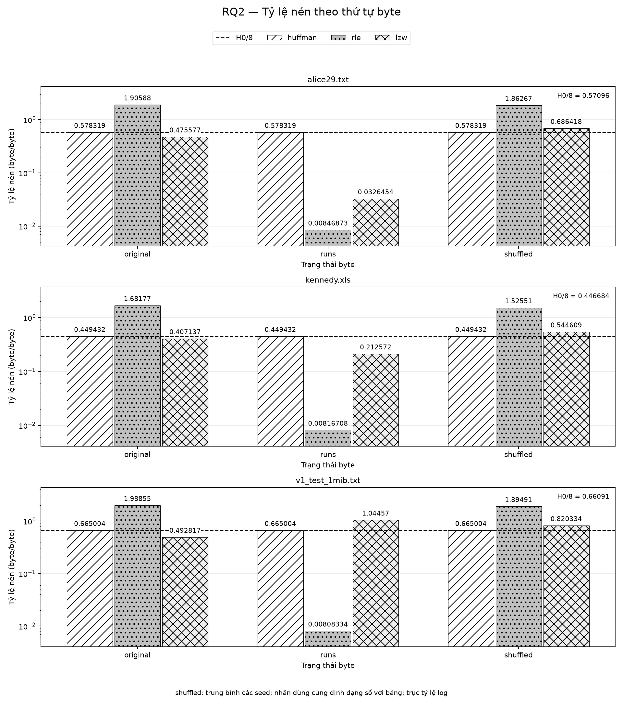
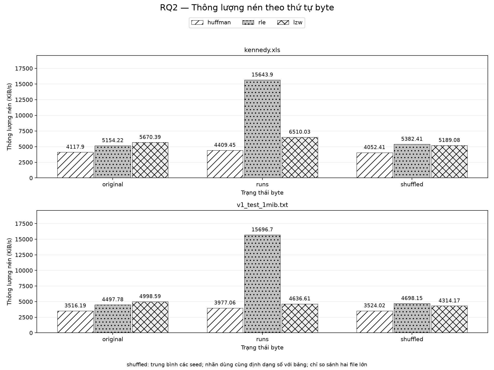

# RQ2 — Ảnh hưởng của thứ tự byte đến hiệu quả nén

Bản sinh tự động bằng `python -m rq2.analyze_rq2 --overwrite --report rq2/RQ2_report_draft.md`. Nguồn duy nhất của kết quả thực nghiệm là `results_rq2_all.csv`; kiểm chứng cơ chế lấy từ `out/mechanism_output.txt`. Không đo lại benchmark. Các mã T ở văn xuôi liên kết tới bảng truy vết cuối báo cáo.

## 1. Mục đích và thiết lập

[ĐO ĐƯỢC] Khảo sát **3** [T001] file, **3** [T002] state (original, runs, shuffled), **3** [T003] codec (Huffman, RLE, LZW). Seeds là **[1, 2, 3]** [T004]; đo **3** [T005] lần lấy trung vị thời gian. Số lần đo lấy từ log cũ được script in lại, không suy ra từ CSV; nhóm còn phải xác nhận thiết lập này.

[ĐO ĐƯỢC] CSV có **45** [T006] dòng, **28** [T007] cột. Tỷ lệ = comp_bytes/orig_bytes, gồm header. Huffman còn ghi ratio_no_header, loại **268** [T008] byte; bảng lấy trực tiếp từ notes của CSV, validator đối chiếu thêm bằng số byte. H0/8 là entropy biên của byte quy về byte/byte. State runs sắp xếp byte tăng dần; shuffled hoán vị byte giữ histogram. Mỗi dòng shuffled ở bảng là trung bình các seed, ratio_min/max giữ khoảng dao động giữa seed. Thông lượng được trung bình từ các giá trị đã ghi trong CSV; không tính ngược từ thời gian trung bình. Đỉnh bộ nhớ đo ở một lượt tracing riêng theo runner hiện có.

[ĐO ĐƯỢC] `alice29.txt` (văn bản tiếng Anh) có **152089** [T009] byte.

[ĐO ĐƯỢC] `kennedy.xls` (dữ liệu nhị phân) có **1029744** [T010] byte.

[ĐO ĐƯỢC] `v1_test_1mib.txt` (văn bản tiếng Việt UTF-8) có **1048576** [T011] byte.

## 2. Kết quả

[ĐO ĐƯỢC] Các bảng dưới được sinh từ CSV. Cột “tốt hơn mốc H0/8?” có nghĩa ratio < h0_ratio; đây là so sánh kích thước, không phải kiểm định ý nghĩa thống kê. Bảng tốc độ giữ dữ liệu alice để tra cứu; chỉ so sánh tốc độ kennedy và V1 ở phần phân tích.

<!-- BEGIN:ratio -->
| file | codec | state | ratio | ratio_min | ratio_max | h0_ratio | ratio_no_header | ratio_minus_h0 | tốt hơn mốc H0/8? |
| --- | --- | --- | --- | --- | --- | --- | --- | --- | --- |
| alice29.txt | huffman | original | 0.578319 | 0.578319 | 0.578319 | 0.57096 | 0.576557 | 0.007359 | không |
| alice29.txt | huffman | runs | 0.578319 | 0.578319 | 0.578319 | 0.57096 | 0.576557 | 0.007359 | không |
| alice29.txt | huffman | shuffled | 0.578319 | 0.578319 | 0.578319 | 0.57096 | 0.576557 | 0.007359 | không |
| alice29.txt | rle | original | 1.90588 | 1.90588 | 1.90588 | 0.57096 |  | 1.33492 | không |
| alice29.txt | rle | runs | 0.00846873 | 0.00846873 | 0.00846873 | 0.57096 |  | -0.562491 | có |
| alice29.txt | rle | shuffled | 1.86267 | 1.86261 | 1.86273 | 0.57096 |  | 1.29171 | không |
| alice29.txt | lzw | original | 0.475577 | 0.475577 | 0.475577 | 0.57096 |  | -0.095383 | có |
| alice29.txt | lzw | runs | 0.0326454 | 0.0326454 | 0.0326454 | 0.57096 |  | -0.538315 | có |
| alice29.txt | lzw | shuffled | 0.686418 | 0.684599 | 0.688906 | 0.57096 |  | 0.115458 | không |
| kennedy.xls | huffman | original | 0.449432 | 0.449432 | 0.449432 | 0.446684 | 0.449172 | 0.002748 | không |
| kennedy.xls | huffman | runs | 0.449432 | 0.449432 | 0.449432 | 0.446684 | 0.449172 | 0.002748 | không |
| kennedy.xls | huffman | shuffled | 0.449432 | 0.449432 | 0.449432 | 0.446684 | 0.449172 | 0.002748 | không |
| kennedy.xls | rle | original | 1.68177 | 1.68177 | 1.68177 | 0.446684 |  | 1.23509 | không |
| kennedy.xls | rle | runs | 0.00816708 | 0.00816708 | 0.00816708 | 0.446684 |  | -0.438517 | có |
| kennedy.xls | rle | shuffled | 1.52551 | 1.52521 | 1.52582 | 0.446684 |  | 1.07883 | không |
| kennedy.xls | lzw | original | 0.407137 | 0.407137 | 0.407137 | 0.446684 |  | -0.039547 | có |
| kennedy.xls | lzw | runs | 0.212572 | 0.212572 | 0.212572 | 0.446684 |  | -0.234112 | có |
| kennedy.xls | lzw | shuffled | 0.544609 | 0.543201 | 0.545722 | 0.446684 |  | 0.0979247 | không |
| v1_test_1mib.txt | huffman | original | 0.665004 | 0.665004 | 0.665004 | 0.66091 | 0.664748 | 0.004094 | không |
| v1_test_1mib.txt | huffman | runs | 0.665004 | 0.665004 | 0.665004 | 0.66091 | 0.664748 | 0.004094 | không |
| v1_test_1mib.txt | huffman | shuffled | 0.665004 | 0.665004 | 0.665004 | 0.66091 | 0.664748 | 0.004094 | không |
| v1_test_1mib.txt | rle | original | 1.98855 | 1.98855 | 1.98855 | 0.66091 |  | 1.32764 | không |
| v1_test_1mib.txt | rle | runs | 0.00808334 | 0.00808334 | 0.00808334 | 0.66091 |  | -0.652827 | có |
| v1_test_1mib.txt | rle | shuffled | 1.89491 | 1.89462 | 1.89512 | 0.66091 |  | 1.234 | không |
| v1_test_1mib.txt | lzw | original | 0.492817 | 0.492817 | 0.492817 | 0.66091 |  | -0.168093 | có |
| v1_test_1mib.txt | lzw | runs | 1.04457 | 1.04457 | 1.04457 | 0.66091 |  | 0.38366 | không |
| v1_test_1mib.txt | lzw | shuffled | 0.820334 | 0.8184 | 0.821305 | 0.66091 |  | 0.159424 | không |
<!-- END:ratio -->

<!-- BEGIN:speed -->
| file | codec | state | comp_kibs | decomp_kibs | peak_mem_kib | ratio_minus_h0 | tốt hơn mốc H0/8? |
| --- | --- | --- | --- | --- | --- | --- | --- |
| alice29.txt | huffman | original | 6953.33 | 2702.77 | 5752.79 | 0.007359 | không |
| alice29.txt | huffman | runs | 7820.9 | 3113.85 | 5752.79 | 0.007359 | không |
| alice29.txt | huffman | shuffled | 4585.55 | 1340.42 | 5752.79 | 0.007359 | không |
| alice29.txt | rle | original | 8950.27 | 7241.98 | 585.266 | 1.33492 | không |
| alice29.txt | rle | runs | 31137.2 | 1.01939e+06 | 311.476 | -0.562491 | có |
| alice29.txt | rle | shuffled | 4829.62 | 4232.03 | 591.642 | 1.29171 | không |
| alice29.txt | lzw | original | 10001.6 | 16639 | 552.84 | -0.095383 | có |
| alice29.txt | lzw | runs | 13390.6 | 123165 | 610.663 | -0.538315 | có |
| alice29.txt | lzw | shuffled | 4744.69 | 5755.79 | 590.515 | 0.115458 | không |
| kennedy.xls | huffman | original | 4117.9 | 1690.52 | 30272.4 | 0.002748 | không |
| kennedy.xls | huffman | runs | 4409.45 | 1709.53 | 30272.4 | 0.002748 | không |
| kennedy.xls | huffman | shuffled | 4052.41 | 1640.08 | 30272.4 | 0.002748 | không |
| kennedy.xls | rle | original | 5154.22 | 4345.24 | 3803.72 | 1.23509 | không |
| kennedy.xls | rle | runs | 15643.9 | 348661 | 2080.36 | -0.438517 | có |
| kennedy.xls | rle | shuffled | 5382.41 | 5091.38 | 3616.23 | 1.07883 | không |
| kennedy.xls | lzw | original | 5670.39 | 9855.05 | 2697.43 | -0.039547 | có |
| kennedy.xls | lzw | runs | 6510.03 | 17734.3 | 3305.49 | -0.234112 | có |
| kennedy.xls | lzw | shuffled | 5189.08 | 7289.61 | 2783.12 | 0.0979247 | không |
| v1_test_1mib.txt | huffman | original | 3516.19 | 1130.2 | 45961.2 | 0.004094 | không |
| v1_test_1mib.txt | huffman | runs | 3977.06 | 1308.69 | 45961.2 | 0.004094 | không |
| v1_test_1mib.txt | huffman | shuffled | 3524.02 | 1123.23 | 45961.2 | 0.004094 | không |
| v1_test_1mib.txt | rle | original | 4497.78 | 3826.9 | 4251.85 | 1.32764 | không |
| v1_test_1mib.txt | rle | runs | 15696.7 | 237786 | 2097.99 | -0.652827 | có |
| v1_test_1mib.txt | rle | shuffled | 4698.15 | 4099.41 | 4057.89 | 1.234 | không |
| v1_test_1mib.txt | lzw | original | 4998.59 | 7243.36 | 2737.01 | -0.168093 | có |
| v1_test_1mib.txt | lzw | runs | 4636.61 | 3975.84 | 3680.08 | 0.38366 | không |
| v1_test_1mib.txt | lzw | shuffled | 4314.17 | 4782.03 | 3144.78 | 0.159424 | không |
<!-- END:speed -->

<!-- BEGIN:comparison -->
| file | state | huffman | rle | lzw | codec thắng (ratio nhỏ nhất) | chênh lệch với hạng nhì |
| --- | --- | --- | --- | --- | --- | --- |
| alice29.txt | original | 0.578319 | 1.90588 | 0.475577 | lzw | 0.102742 |
| alice29.txt | runs | 0.578319 | 0.00846873 | 0.0326454 | rle | 0.0241767 |
| alice29.txt | shuffled | 0.578319 | 1.86267 | 0.686418 | huffman | 0.108099 |
| kennedy.xls | original | 0.449432 | 1.68177 | 0.407137 | lzw | 0.042295 |
| kennedy.xls | runs | 0.449432 | 0.00816708 | 0.212572 | rle | 0.204405 |
| kennedy.xls | shuffled | 0.449432 | 1.52551 | 0.544609 | huffman | 0.0951767 |
| v1_test_1mib.txt | original | 0.665004 | 1.98855 | 0.492817 | lzw | 0.172187 |
| v1_test_1mib.txt | runs | 0.665004 | 0.00808334 | 1.04457 | rle | 0.656921 |
| v1_test_1mib.txt | shuffled | 0.665004 | 1.89491 | 0.820334 | huffman | 0.15533 |
<!-- END:comparison -->

## 3. Phân tích từng codec

### Huffman

[ĐO ĐƯỢC] `alice29.txt`/huffman ở original, runs và từng seed shuffled đều có comp_bytes = **87956** [T012] byte; ratio = **0.578319** [T013]; ratio không header = **0.576557** [T014].

[ĐO ĐƯỢC] `kennedy.xls`/huffman ở original, runs và từng seed shuffled đều có comp_bytes = **462800** [T015] byte; ratio = **0.449432** [T016]; ratio không header = **0.449172** [T017].

[ĐO ĐƯỢC] `v1_test_1mib.txt`/huffman ở original, runs và từng seed shuffled đều có comp_bytes = **697307** [T018] byte; ratio = **0.665004** [T019]; ratio không header = **0.664748** [T020].

[GIẢI THÍCH - cần kiểm chứng] Lý thuyết mã tĩnh bậc không: H0 chỉ phụ thuộc histogram; hoán vị byte giữ histogram nên giữ H0. Huffman tĩnh xây độ dài mã từ histogram, do đó tổng số bit mã, padding và header cố định giữ nguyên kích thước. Đây là lập luận lý thuyết; sự bất biến trên các file ở trên là phần đo được, không khẳng định mọi blob nén giống nhau hay mọi cách cài đặt Huffman đều có cùng overhead.

### RLE

[ĐO ĐƯỢC] `alice29.txt`/rle: original = **1.90588** [T021], runs = **0.00846873** [T022], shuffled = **1.86267** [T023]. Runs nén mạnh; original và shuffled đều phình so với dữ liệu đầu vào.

[ĐO ĐƯỢC] `kennedy.xls`/rle: original = **1.68177** [T024], runs = **0.00816708** [T025], shuffled = **1.52551** [T026]. Runs nén mạnh; original và shuffled đều phình so với dữ liệu đầu vào.

[ĐO ĐƯỢC] `v1_test_1mib.txt`/rle: original = **1.98855** [T027], runs = **0.00808334** [T028], shuffled = **1.89491** [T029]. Runs nén mạnh; original và shuffled đều phình so với dữ liệu đầu vào.

[GIẢI THÍCH - cần kiểm chứng] Gom các byte bằng nhau tạo run dài và giảm số cặp đếm/byte. Giới hạn count là **255** [T030], header RLE là **12** [T031] byte; validator kiểm tra kích thước runs bằng header cộng số byte của các cặp sau tách run. Đây là công thức của định dạng; không phải giả định rằng chỉ cần một cặp cho mỗi giá trị byte.

### LZW và phân tích theo file

[ĐO ĐƯỢC] `alice29.txt` (văn bản tiếng Anh)/lzw: original = **0.475577** [T032], runs = **0.0326454** [T033], shuffled trung bình = **0.686418** [T034], shuffled nhỏ nhất = **0.684599** [T035]. Mọi seed shuffled đều kém original. Gom run cải thiện LZW; RLE-runs vẫn nhỏ hơn. Ở original, LZW có tỷ lệ thấp nhất trong các codec; ở shuffled, Huffman thấp nhất (xem bảng cùng state).

[ĐO ĐƯỢC] `kennedy.xls` (dữ liệu nhị phân)/lzw: original = **0.407137** [T036], runs = **0.212572** [T037], shuffled trung bình = **0.544609** [T038], shuffled nhỏ nhất = **0.543201** [T039]. Mọi seed shuffled đều kém original. Gom run cải thiện LZW; RLE-runs vẫn nhỏ hơn. Ở original, LZW có tỷ lệ thấp nhất trong các codec; ở shuffled, Huffman thấp nhất (xem bảng cùng state).

[ĐO ĐƯỢC] `v1_test_1mib.txt` (văn bản tiếng Việt UTF-8)/lzw: original = **0.492817** [T040], runs = **1.04457** [T041], shuffled trung bình = **0.820334** [T042], shuffled nhỏ nhất = **0.8184** [T043]. Mọi seed shuffled đều kém original. Gom run làm LZW phình; RLE-runs vẫn nhỏ hơn rất nhiều. Ở original, LZW có tỷ lệ thấp nhất trong các codec; ở shuffled, Huffman thấp nhất (xem bảng cùng state).

### Tốc độ và bộ nhớ

[ĐO ĐƯỢC] Chỉ so sánh tốc độ trên kennedy.xls và v1_test_1mib.txt. alice29.txt nhỏ hơn đáng kể; riêng thời gian nén huffman/original là **21.3602** [T044] ms. [GIẢI THÍCH - cần kiểm chứng] Khoảng thời gian ngắn dễ bị ảnh hưởng bởi scheduling và nhiễu hệ thống; CSV không giữ các lần lặp riêng nên chưa định lượng được mức nhiễu.

[ĐO ĐƯỢC] `kennedy.xls`/original: tốc độ nén huffman/rle/lzw lần lượt là **4117.9** [T045], **5154.22** [T046], **5670.39** [T047] KiB/s; giải nén lần lượt là **1690.52** [T048], **4345.24** [T049], **9855.05** [T050] KiB/s. RLE/runs đạt **15643.9** [T051] KiB/s, cao hơn RLE/original trong phép đo này. Bộ nhớ đỉnh huffman/rle/lzw ở original lần lượt là **30272.4** [T052], **3803.72** [T053], **2697.43** [T054] KiB.

[ĐO ĐƯỢC] `v1_test_1mib.txt`/original: tốc độ nén huffman/rle/lzw lần lượt là **3516.19** [T055], **4497.78** [T056], **4998.59** [T057] KiB/s; giải nén lần lượt là **1130.2** [T058], **3826.9** [T059], **7243.36** [T060] KiB/s. RLE/runs đạt **15696.7** [T061] KiB/s, cao hơn RLE/original trong phép đo này. Bộ nhớ đỉnh huffman/rle/lzw ở original lần lượt là **45961.2** [T062], **4251.85** [T063], **2737.01** [T064] KiB.

[ĐO ĐƯỢC] Bảng cho thấy bộ nhớ đỉnh Huffman cao hơn RLE và LZW ở mọi file/state. [GIẢI THÍCH - cần kiểm chứng] Mã Huffman hiện có tạo chuỗi ký tự bit trong Python khi nén và giải nén; điều này phù hợp với mức bộ nhớ cao. Đây là đặc điểm cài đặt, không phải bản chất bắt buộc của thuật toán Huffman; chưa đo một cài đặt khác để tách riêng đóng góp của chuỗi bit.

## 4. So với mốc H0/8

[ĐO ĐƯỢC] Huffman có ratio cao hơn H0/8 từ **0.002748** [T065] đến **0.007359** [T066]. Giữ cùng quy tắc định dạng với bảng; không thay bằng khoảng xấp xỉ khác.

[ĐO ĐƯỢC] `alice29.txt`: lzw/original = **0.475577** [T067] < H0/8 = **0.57096** [T068]; Huffman bỏ header vẫn = **0.576557** [T069] > H0/8. Khi shuffled, LZW = **0.686418** [T070] > Huffman = **0.578319** [T071]. Kết quả đúng cả với alice, không chỉ kennedy và V1.

[ĐO ĐƯỢC] `kennedy.xls`: lzw/original = **0.407137** [T072] < H0/8 = **0.446684** [T073]; Huffman bỏ header vẫn = **0.449172** [T074] > H0/8. Khi shuffled, LZW = **0.544609** [T075] > Huffman = **0.449432** [T076]. Kết quả đúng cả với alice, không chỉ kennedy và V1.

[ĐO ĐƯỢC] `v1_test_1mib.txt`: lzw/original = **0.492817** [T077] < H0/8 = **0.66091** [T078]; Huffman bỏ header vẫn = **0.664748** [T079] > H0/8. Khi shuffled, LZW = **0.820334** [T080] > Huffman = **0.665004** [T081]. Kết quả đúng cả với alice, không chỉ kennedy và V1.

[GIẢI THÍCH - cần kiểm chứng] H0/8 không phải cận dưới cho codec dựa trên ngữ cảnh. Entropy biên bỏ qua phụ thuộc giữa các byte; mã chuỗi có thể khai thác các cụm lặp để xuống dưới mốc này. Xáo trộn phá cấu trúc chuỗi trong khi giữ histogram, phù hợp với việc LZW mất lợi thế; không diễn giải thành vi phạm giới hạn entropy của nguồn có ngữ cảnh.

## 5. Giả thuyết và kết quả

<!-- BEGIN:hypotheses -->
| Giả thuyết | Verdict | Căn cứ [ĐO ĐƯỢC] |
| --- | --- | --- |
| Huffman bất biến và không thấp hơn H0/8, kể cả bỏ header | ĐÚNG | comp_bytes và ratio_no_header: phần Huffman; chênh lệch H0: phần so mốc |
| RLE tốt sau gom run, phình ở original/shuffled | ĐÚNG | ratio và ratio_min: bảng tỷ lệ và phần RLE |
| LZW tệ đi sau xáo trộn ở từng file, từng seed | ĐÚNG | ratio_min shuffled lớn hơn original: phần LZW |
| Gom run luôn cải thiện LZW | ĐÚNG MỘT PHẦN; mệnh đề luôn là SAI | Cải thiện: alice29.txt, kennedy.xls; còn lại: v1_test_1mib.txt |
<!-- END:hypotheses -->

## 6. Thảo luận cơ chế

### Bất thường: LZW-runs trên V1 phình, alice rất thấp

[ĐO ĐƯỢC] `alice29.txt`/lzw: runs = **0.0326454** [T082], original = **0.475577** [T083]; chênh lệch runs − original = **-0.442932** [T084]. Từ điển runs không đầy.

[ĐO ĐƯỢC] `kennedy.xls`/lzw: runs = **0.212572** [T085], original = **0.407137** [T086]; chênh lệch runs − original = **-0.194565** [T087]. Từ điển runs đầy tại chỉ số byte **887662** [T088], tương ứng **86** [T089]% dữ liệu; phần sau dùng từ điển đóng băng là **14** [T090]% (tỷ lệ phần trăm đã làm tròn theo script).

[ĐO ĐƯỢC] `v1_test_1mib.txt`/lzw: runs = **1.04457** [T091], original = **0.492817** [T092]; chênh lệch runs − original = **0.551753** [T093]. Từ điển runs đầy tại chỉ số byte **319103** [T094], tương ứng **30** [T095]% dữ liệu; phần sau dùng từ điển đóng băng là **70** [T096]% (tỷ lệ phần trăm đã làm tròn theo script).

[ĐO ĐƯỢC] Script xác nhận từ điển giới hạn **4096** [T097] mục đầy sớm hơn trên V1-runs so với kennedy-runs; alice-runs không đầy. [GIẢI THÍCH - cần kiểm chứng] Khi duyệt dữ liệu đã sắp xếp, các mục từ điển có thể được dùng hết cho những giá trị byte xuất hiện trước, khiến các giá trị xuất hiện sau không được học cụm mới. Kết quả thời điểm đầy phù hợp với cơ chế này. Chỉ số đầy không dự đoán một tỷ lệ nén cụ thể: chưa có phép đo đối chứng thay chính sách từ điển, nên chưa xác nhận nguyên nhân đầy đủ hay độ lớn của mức phình. Không kết luận chỉ số lượng giá trị byte quyết định kết quả: kennedy có nhiều giá trị byte hơn V1 nhưng đầy muộn hơn. LZW-original cũng đầy theo output script; đầy từ điển tự nó không đủ giải thích.

### Bất thường: RLE-original của kennedy tệ hơn shuffled

[ĐO ĐƯỢC] `alice29.txt`/rle: sum(p²) = **0.0687** [T098]; dự đoán shuffled = **1.8626** [T099], CSV = **1.86267** [T100], chênh lệch CSV − dự đoán = **8.60558e-05** [T101]; dự đoán original = **1.9058** [T102], CSV = **1.90588** [T103], chênh lệch = **7.48464e-05** [T104]. Kết luận đối chiếu trong script: KHỚP.

[ĐO ĐƯỢC] `kennedy.xls`/rle: sum(p²) = **0.2369** [T105]; dự đoán shuffled = **1.5262** [T106], CSV = **1.52551** [T107], chênh lệch CSV − dự đoán = **-0.000694301** [T108]; dự đoán original = **1.6818** [T109], CSV = **1.68177** [T110], chênh lệch = **1.41461e-05** [T111]. Kết luận đối chiếu trong script: KHỚP.

[ĐO ĐƯỢC] `v1_test_1mib.txt`/rle: sum(p²) = **0.0525** [T112]; dự đoán shuffled = **1.8950** [T113], CSV = **1.89491** [T114], chênh lệch CSV − dự đoán = **-0.000134406** [T115]; dự đoán original = **1.9885** [T116], CSV = **1.98855** [T117], chênh lệch = **1.50726e-05** [T118]. Kết luận đối chiếu trong script: KHỚP.

[ĐO ĐƯỢC] Sai số tuyệt đối của các dự đoán RLE đều nhỏ hơn ngưỡng đối chiếu **0.05** [T119]. Sai lệch được tính trước khi định dạng số nên có thể khác phép trừ trực tiếp hai số đã làm tròn. Riêng kennedy, cả dự đoán và CSV đều cho shuffled thấp hơn original. [GIẢI THÍCH - cần kiểm chứng] Với hoán vị ngẫu nhiên, xác suất byte kề nhau bằng nhau gần sum(p²), nên tỷ lệ RLE gần hai lần xác suất đổi byte. Công thức kỳ vọng bỏ qua header, tách run dài và hiệu chỉnh lấy mẫu không hoàn lại; đối chiếu hiện tại ủng hộ cơ chế này cho kennedy, không xác nhận mọi hoán vị đều có cùng kết quả. Phân tích theo số run gốc giải thích được vì sao một file nhị phân vẫn có thể nhiều chuyển byte hơn bản xáo trộn.

## 7. Hạn chế

- [ĐO ĐƯỢC] `tracemalloc` theo dõi bộ nhớ do Python cấp phát trong lượt nén và giải nén riêng, không đo toàn bộ RSS hoặc mọi cấp phát native. CSV chỉ lưu giá trị tổng hợp; không còn phân bố từng lần đo để tính độ không chắc chắn.

- [ĐO ĐƯỢC] Chỉ dùng các seed và số lần đo nêu ở phần thiết lập trên một máy; chưa kiểm chứng tính tái lập trên máy khác. Seed và số lần đo vẫn chờ nhóm xác nhận. Chỉ so sánh tốc độ trên kennedy và V1.

- [GIẢI THÍCH - cần kiểm chứng] Header Huffman cố định ảnh hưởng tỷ lệ ở file nhỏ mạnh hơn. V1 được Cặp 1 chuẩn bị bằng cách cắt tại ranh giới ký tự UTF-8 nên về quy trình có thể ngắn hơn danh nghĩa vài byte; file hiện tại có đúng kích thước ghi ở phần thiết lập, không quan sát thấy thiếu byte danh nghĩa trong bản này.

- [ĐO ĐƯỢC] LZW đóng băng từ điển theo yêu cầu đề; không thay bằng reset hay tăng kích thước. Việc kiểm tra thời điểm đầy chưa phải phép kiểm định nhân quả.

- Schema CSV của Cặp 1 và nhóm 2 có cùng số cột nêu ở thiết lập nhưng khác API: Cặp 1 dùng `CsvWriter`, `h0_bits`, `throughput_kibs`; nhóm 2 dùng `append_row`, `finalize_row`, `validate_row`, `sha16`. `common/csv_schema.md` vẫn là đề xuất chờ nhóm chốt; chưa thay schema hay sửa code Cặp 1.

- Hash rút gọn trong CSV được đối chiếu với file gốc cho state original; không chạy lại giải nén trong lượt phân tích này. Validator dùng cờ round-trip và log của lượt đo trước. Không diễn giải thành tái đo toàn bộ phép thử.

- Không thêm tài liệu tham khảo chưa kiểm chứng; bản này chưa trích dẫn tài liệu ngoài. Khi ghép báo cáo chung chỉ dùng các tài liệu bắt buộc của đề đã được nhóm đối chiếu.

## 8. Kết luận

[ĐO ĐƯỢC] Trên bộ dữ liệu đã đo, Huffman giữ kích thước theo thứ tự byte; RLE hưởng lợi mạnh từ gom run; LZW kém đi sau xáo trộn và không luôn tốt lên sau gom run. LZW-original xuống dưới mốc H0/8 trên mọi file, nhưng Huffman có tỷ lệ tốt nhất ở shuffled. Kết quả cơ chế RLE khớp gần đúng; cơ chế từ điển LZW được hỗ trợ bởi thời điểm đầy, còn quan hệ nhân quả cần đối chứng. Những kết quả này chỉ mô tả bộ dữ liệu và cài đặt đã đo.

## Truy vết số liệu

Mỗi giá trị định lượng trích ở văn xuôi có mã T. CSV đánh số dòng vật lý, header là dòng đầu; MECH đánh số dòng trong `out/mechanism_output.txt`. `mean`, `min`, `max` áp dụng lên các dòng liệt kê; `ratio-h0_ratio` tính trước khi tổng hợp; `slice` trích nguyên văn đoạn ký tự của dòng output. Các hằng trong tên file, tên thuật toán, biểu thức lý thuyết và số thứ tự mục không phải kết quả đo. Bảng kết quả được kiểm tra độc lập bằng cách sinh lại từ CSV; bảng truy vết được kiểm tra bởi `verify_report.py`.

<!-- BEGIN:trace -->
| ID | Nhận định | file/codec/state | Nguồn | Phép tính | Giá trị |
| --- | --- | --- | --- | --- | --- |
| T001 | Số file | thiết lập/script | MECH:4 | slice(22,23) | 3 |
| T002 | Số state | thiết lập/script | MECH:4 | slice(30,31) | 3 |
| T003 | Số codec | thiết lập/script | MECH:4 | slice(39,40) | 3 |
| T004 | Danh sách seed | thiết lập/script | MECH:4 | slice(56,65) | [1, 2, 3] |
| T005 | Số lần đo theo log | thiết lập/script | MECH:5 | slice(57,58) | 3 |
| T006 | Số dòng CSV | thiết lập/script | MECH:4 | slice(5,7) | 45 |
| T007 | Số cột CSV | thiết lập/script | MECH:4 | slice(14,16) | 28 |
| T008 | Header Huffman | thiết lập/script | MECH:6 | slice(53,56) | 268 |
| T009 | Kích thước file | alice29.txt/huffman/original | CSV:2 | mean(orig_bytes) | 152089 |
| T010 | Kích thước file | kennedy.xls/huffman/original | CSV:17 | mean(orig_bytes) | 1029744 |
| T011 | Kích thước file | v1_test_1mib.txt/huffman/original | CSV:32 | mean(orig_bytes) | 1048576 |
| T012 | Kích thước Huffman bất biến (validator kiểm tra từng dòng) | alice29.txt/huffman/* | CSV:2,5,8,11,14 | mean(comp_bytes) | 87956 |
| T013 | ratio | alice29.txt/huffman/original | CSV:2 | mean(ratio) | 0.578319 |
| T014 | ratio_no_header | alice29.txt/huffman/original | CSV:2 | mean(ratio_no_header) | 0.576557 |
| T015 | Kích thước Huffman bất biến (validator kiểm tra từng dòng) | kennedy.xls/huffman/* | CSV:17,20,23,26,29 | mean(comp_bytes) | 462800 |
| T016 | ratio | kennedy.xls/huffman/original | CSV:17 | mean(ratio) | 0.449432 |
| T017 | ratio_no_header | kennedy.xls/huffman/original | CSV:17 | mean(ratio_no_header) | 0.449172 |
| T018 | Kích thước Huffman bất biến (validator kiểm tra từng dòng) | v1_test_1mib.txt/huffman/* | CSV:32,35,38,41,44 | mean(comp_bytes) | 697307 |
| T019 | ratio | v1_test_1mib.txt/huffman/original | CSV:32 | mean(ratio) | 0.665004 |
| T020 | ratio_no_header | v1_test_1mib.txt/huffman/original | CSV:32 | mean(ratio_no_header) | 0.664748 |
| T021 | ratio | alice29.txt/rle/original | CSV:3 | mean(ratio) | 1.90588 |
| T022 | ratio | alice29.txt/rle/runs | CSV:6 | mean(ratio) | 0.00846873 |
| T023 | ratio | alice29.txt/rle/shuffled | CSV:9,12,15 | mean(ratio) | 1.86267 |
| T024 | ratio | kennedy.xls/rle/original | CSV:18 | mean(ratio) | 1.68177 |
| T025 | ratio | kennedy.xls/rle/runs | CSV:21 | mean(ratio) | 0.00816708 |
| T026 | ratio | kennedy.xls/rle/shuffled | CSV:24,27,30 | mean(ratio) | 1.52551 |
| T027 | ratio | v1_test_1mib.txt/rle/original | CSV:33 | mean(ratio) | 1.98855 |
| T028 | ratio | v1_test_1mib.txt/rle/runs | CSV:36 | mean(ratio) | 0.00808334 |
| T029 | ratio | v1_test_1mib.txt/rle/shuffled | CSV:39,42,45 | mean(ratio) | 1.89491 |
| T030 | Giới hạn count RLE | thiết lập/script | MECH:6 | slice(116,119) | 255 |
| T031 | Header RLE | thiết lập/script | MECH:6 | slice(92,94) | 12 |
| T032 | ratio | alice29.txt/lzw/original | CSV:4 | mean(ratio) | 0.475577 |
| T033 | ratio | alice29.txt/lzw/runs | CSV:7 | mean(ratio) | 0.0326454 |
| T034 | ratio | alice29.txt/lzw/shuffled | CSV:10,13,16 | mean(ratio) | 0.686418 |
| T035 | ratio | alice29.txt/lzw/shuffled | CSV:10,13,16 | min(ratio) | 0.684599 |
| T036 | ratio | kennedy.xls/lzw/original | CSV:19 | mean(ratio) | 0.407137 |
| T037 | ratio | kennedy.xls/lzw/runs | CSV:22 | mean(ratio) | 0.212572 |
| T038 | ratio | kennedy.xls/lzw/shuffled | CSV:25,28,31 | mean(ratio) | 0.544609 |
| T039 | ratio | kennedy.xls/lzw/shuffled | CSV:25,28,31 | min(ratio) | 0.543201 |
| T040 | ratio | v1_test_1mib.txt/lzw/original | CSV:34 | mean(ratio) | 0.492817 |
| T041 | ratio | v1_test_1mib.txt/lzw/runs | CSV:37 | mean(ratio) | 1.04457 |
| T042 | ratio | v1_test_1mib.txt/lzw/shuffled | CSV:40,43,46 | mean(ratio) | 0.820334 |
| T043 | ratio | v1_test_1mib.txt/lzw/shuffled | CSV:40,43,46 | min(ratio) | 0.8184 |
| T044 | Thời gian alice, chỉ để nêu hạn chế | alice29.txt/huffman/original | CSV:2 | mean(comp_ms) | 21.3602 |
| T045 | Tốc độ nén original | kennedy.xls/huffman/original | CSV:17 | mean(comp_kibs) | 4117.9 |
| T046 | Tốc độ nén original | kennedy.xls/rle/original | CSV:18 | mean(comp_kibs) | 5154.22 |
| T047 | Tốc độ nén original | kennedy.xls/lzw/original | CSV:19 | mean(comp_kibs) | 5670.39 |
| T048 | Tốc độ giải nén original | kennedy.xls/huffman/original | CSV:17 | mean(decomp_kibs) | 1690.52 |
| T049 | Tốc độ giải nén original | kennedy.xls/rle/original | CSV:18 | mean(decomp_kibs) | 4345.24 |
| T050 | Tốc độ giải nén original | kennedy.xls/lzw/original | CSV:19 | mean(decomp_kibs) | 9855.05 |
| T051 | Tốc độ nén RLE-runs | kennedy.xls/rle/runs | CSV:21 | mean(comp_kibs) | 15643.9 |
| T052 | Bộ nhớ đỉnh original | kennedy.xls/huffman/original | CSV:17 | mean(peak_mem_kib) | 30272.4 |
| T053 | Bộ nhớ đỉnh original | kennedy.xls/rle/original | CSV:18 | mean(peak_mem_kib) | 3803.72 |
| T054 | Bộ nhớ đỉnh original | kennedy.xls/lzw/original | CSV:19 | mean(peak_mem_kib) | 2697.43 |
| T055 | Tốc độ nén original | v1_test_1mib.txt/huffman/original | CSV:32 | mean(comp_kibs) | 3516.19 |
| T056 | Tốc độ nén original | v1_test_1mib.txt/rle/original | CSV:33 | mean(comp_kibs) | 4497.78 |
| T057 | Tốc độ nén original | v1_test_1mib.txt/lzw/original | CSV:34 | mean(comp_kibs) | 4998.59 |
| T058 | Tốc độ giải nén original | v1_test_1mib.txt/huffman/original | CSV:32 | mean(decomp_kibs) | 1130.2 |
| T059 | Tốc độ giải nén original | v1_test_1mib.txt/rle/original | CSV:33 | mean(decomp_kibs) | 3826.9 |
| T060 | Tốc độ giải nén original | v1_test_1mib.txt/lzw/original | CSV:34 | mean(decomp_kibs) | 7243.36 |
| T061 | Tốc độ nén RLE-runs | v1_test_1mib.txt/rle/runs | CSV:36 | mean(comp_kibs) | 15696.7 |
| T062 | Bộ nhớ đỉnh original | v1_test_1mib.txt/huffman/original | CSV:32 | mean(peak_mem_kib) | 45961.2 |
| T063 | Bộ nhớ đỉnh original | v1_test_1mib.txt/rle/original | CSV:33 | mean(peak_mem_kib) | 4251.85 |
| T064 | Bộ nhớ đỉnh original | v1_test_1mib.txt/lzw/original | CSV:34 | mean(peak_mem_kib) | 2737.01 |
| T065 | Chênh lệch Huffman–H0 nhỏ nhất | */huffman/* | CSV:2,5,8,11,14,17,20,23,26,29,32,35,38,41,44 | min(ratio-h0_ratio) | 0.002748 |
| T066 | Chênh lệch Huffman–H0 lớn nhất | */huffman/* | CSV:2,5,8,11,14,17,20,23,26,29,32,35,38,41,44 | max(ratio-h0_ratio) | 0.007359 |
| T067 | ratio | alice29.txt/lzw/original | CSV:4 | mean(ratio) | 0.475577 |
| T068 | h0_ratio | alice29.txt/huffman/original | CSV:2 | mean(h0_ratio) | 0.57096 |
| T069 | ratio_no_header | alice29.txt/huffman/original | CSV:2 | mean(ratio_no_header) | 0.576557 |
| T070 | ratio | alice29.txt/lzw/shuffled | CSV:10,13,16 | mean(ratio) | 0.686418 |
| T071 | ratio | alice29.txt/huffman/shuffled | CSV:8,11,14 | mean(ratio) | 0.578319 |
| T072 | ratio | kennedy.xls/lzw/original | CSV:19 | mean(ratio) | 0.407137 |
| T073 | h0_ratio | kennedy.xls/huffman/original | CSV:17 | mean(h0_ratio) | 0.446684 |
| T074 | ratio_no_header | kennedy.xls/huffman/original | CSV:17 | mean(ratio_no_header) | 0.449172 |
| T075 | ratio | kennedy.xls/lzw/shuffled | CSV:25,28,31 | mean(ratio) | 0.544609 |
| T076 | ratio | kennedy.xls/huffman/shuffled | CSV:23,26,29 | mean(ratio) | 0.449432 |
| T077 | ratio | v1_test_1mib.txt/lzw/original | CSV:34 | mean(ratio) | 0.492817 |
| T078 | h0_ratio | v1_test_1mib.txt/huffman/original | CSV:32 | mean(h0_ratio) | 0.66091 |
| T079 | ratio_no_header | v1_test_1mib.txt/huffman/original | CSV:32 | mean(ratio_no_header) | 0.664748 |
| T080 | ratio | v1_test_1mib.txt/lzw/shuffled | CSV:40,43,46 | mean(ratio) | 0.820334 |
| T081 | ratio | v1_test_1mib.txt/huffman/shuffled | CSV:38,41,44 | mean(ratio) | 0.665004 |
| T082 | ratio | alice29.txt/lzw/runs | CSV:7 | mean(ratio) | 0.0326454 |
| T083 | ratio | alice29.txt/lzw/original | CSV:4 | mean(ratio) | 0.475577 |
| T084 | Chênh lệch LZW runs-original | alice29.txt/script | MECH:11 | slice(94,103) | -0.442932 |
| T085 | ratio | kennedy.xls/lzw/runs | CSV:22 | mean(ratio) | 0.212572 |
| T086 | ratio | kennedy.xls/lzw/original | CSV:19 | mean(ratio) | 0.407137 |
| T087 | Chênh lệch LZW runs-original | kennedy.xls/script | MECH:17 | slice(160,169) | -0.194565 |
| T088 | Vị trí đầy từ điển runs | kennedy.xls/script | MECH:17 | slice(35,41) | 887662 |
| T089 | Phần trăm vị trí đầy, định dạng script | kennedy.xls/script | MECH:17 | slice(43,45) | 86 |
| T090 | Phần trăm sau khi đầy | kennedy.xls/script | MECH:17 | slice(57,59) | 14 |
| T091 | ratio | v1_test_1mib.txt/lzw/runs | CSV:37 | mean(ratio) | 1.04457 |
| T092 | ratio | v1_test_1mib.txt/lzw/original | CSV:34 | mean(ratio) | 0.492817 |
| T093 | Chênh lệch LZW runs-original | v1_test_1mib.txt/script | MECH:23 | slice(159,167) | 0.551753 |
| T094 | Vị trí đầy từ điển runs | v1_test_1mib.txt/script | MECH:23 | slice(35,41) | 319103 |
| T095 | Phần trăm vị trí đầy, định dạng script | v1_test_1mib.txt/script | MECH:23 | slice(43,45) | 30 |
| T096 | Phần trăm sau khi đầy | v1_test_1mib.txt/script | MECH:23 | slice(57,59) | 70 |
| T097 | Dung lượng từ điển LZW | thiết lập/script | MECH:6 | slice(69,73) | 4096 |
| T098 | Tổng bình phương xác suất byte | alice29.txt/script | MECH:9 | slice(13,19) | 0.0687 |
| T099 | Dự đoán RLE shuffled | alice29.txt/script | MECH:9 | slice(68,74) | 1.8626 |
| T100 | ratio | alice29.txt/rle/shuffled | CSV:9,12,15 | mean(ratio) | 1.86267 |
| T101 | Sai lệch dự đoán RLE shuffled | alice29.txt/script | MECH:9 | slice(99,110) | 8.60558e-05 |
| T102 | Dự đoán RLE original | alice29.txt/script | MECH:10 | slice(54,60) | 1.9058 |
| T103 | ratio | alice29.txt/rle/original | CSV:3 | mean(ratio) | 1.90588 |
| T104 | Sai lệch dự đoán RLE original | alice29.txt/script | MECH:10 | slice(112,123) | 7.48464e-05 |
| T105 | Tổng bình phương xác suất byte | kennedy.xls/script | MECH:15 | slice(13,19) | 0.2369 |
| T106 | Dự đoán RLE shuffled | kennedy.xls/script | MECH:15 | slice(68,74) | 1.5262 |
| T107 | ratio | kennedy.xls/rle/shuffled | CSV:24,27,30 | mean(ratio) | 1.52551 |
| T108 | Sai lệch dự đoán RLE shuffled | kennedy.xls/script | MECH:15 | slice(99,111) | -0.000694301 |
| T109 | Dự đoán RLE original | kennedy.xls/script | MECH:16 | slice(54,60) | 1.6818 |
| T110 | ratio | kennedy.xls/rle/original | CSV:18 | mean(ratio) | 1.68177 |
| T111 | Sai lệch dự đoán RLE original | kennedy.xls/script | MECH:16 | slice(112,123) | 1.41461e-05 |
| T112 | Tổng bình phương xác suất byte | v1_test_1mib.txt/script | MECH:21 | slice(13,19) | 0.0525 |
| T113 | Dự đoán RLE shuffled | v1_test_1mib.txt/script | MECH:21 | slice(68,74) | 1.8950 |
| T114 | ratio | v1_test_1mib.txt/rle/shuffled | CSV:39,42,45 | mean(ratio) | 1.89491 |
| T115 | Sai lệch dự đoán RLE shuffled | v1_test_1mib.txt/script | MECH:21 | slice(99,111) | -0.000134406 |
| T116 | Dự đoán RLE original | v1_test_1mib.txt/script | MECH:22 | slice(55,61) | 1.9885 |
| T117 | ratio | v1_test_1mib.txt/rle/original | CSV:33 | mean(ratio) | 1.98855 |
| T118 | Sai lệch dự đoán RLE original | v1_test_1mib.txt/script | MECH:22 | slice(113,124) | 1.50726e-05 |
| T119 | Ngưỡng đối chiếu RLE | thiết lập/script | MECH:2 | slice(54,58) | 0.05 |
<!-- END:trace -->
