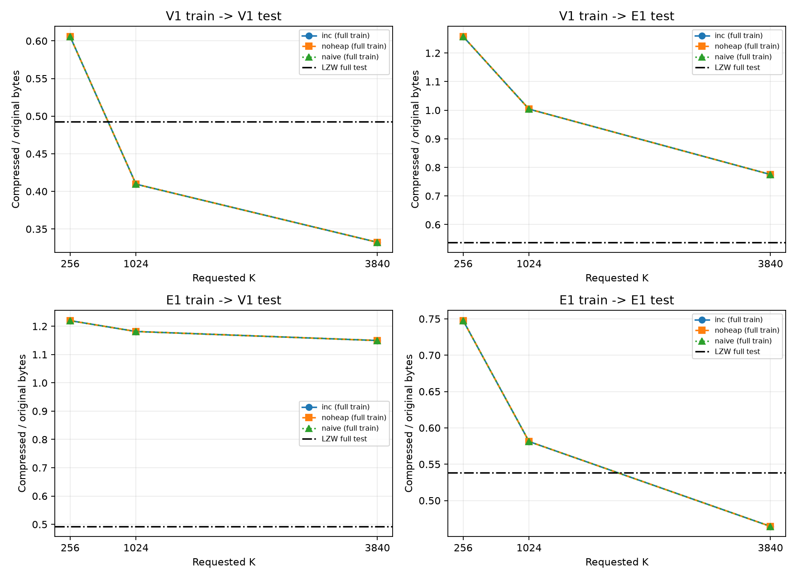
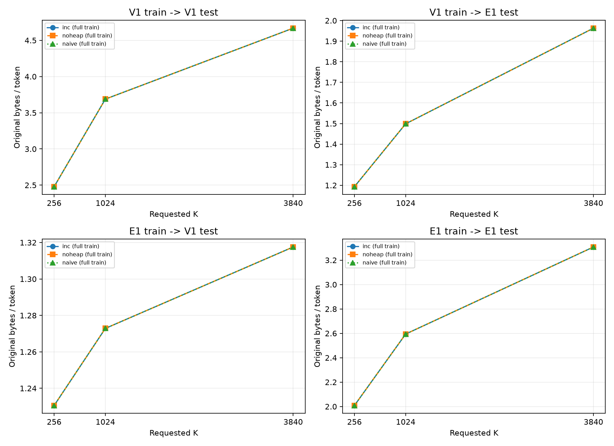
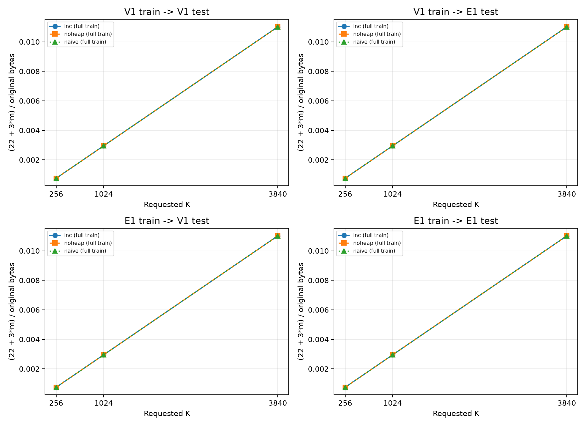
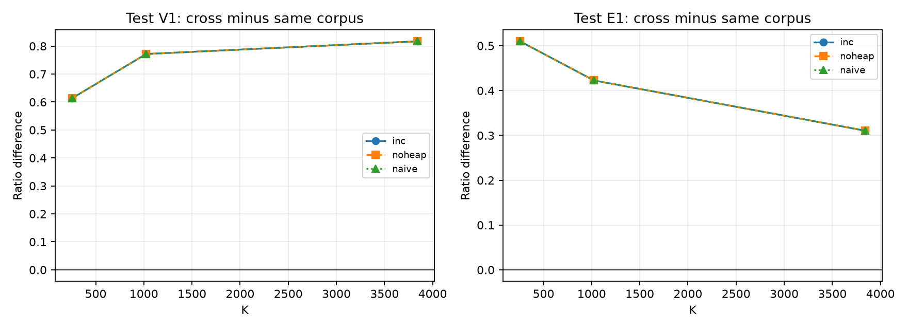
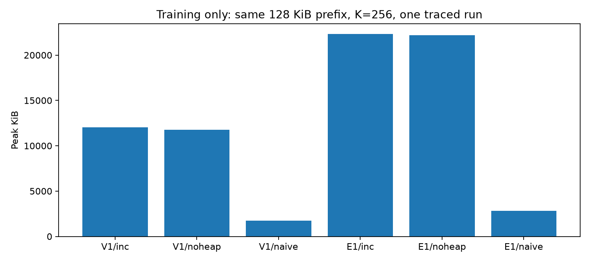

# RQ3 analysis - full-corpus training

## Method

Byte-level BPE follows D1-D8: regex pre-tokenization, weighted unique segments,
overlapping pair counts and left-to-right replacement, deterministic tie-break,
and fixed 12-bit codes. Compressed size includes the 22-byte fixed overhead,
3 bytes per actual merge, and the zero-padded token payload.

inc/noheap train on the full V1/E1 corpora at K=256/1024/3840; train_ms is the
median of 3 runs. naive uses the same full training input at all K; train_ms
is one measured run. Four high-K timings come from the verified supplement;
their test compression, decompression and memory were measured again.
All variants compress/decompress FULL test files. Times are medians of 3 untraced
runs using time.perf_counter. Training is timed separately and reused for both
test corpora. Every restored result is checked against full SHA-256 before CSV.

peak_mem_kib is a separate tracemalloc pass over compress+decompress with the
already-learned table, on FULL test data for every variant. It excludes training
and allocations made before tracing. Separate training-memory measurements use
the SAME 128 KiB prefix, K=256, one traced run per corpus/variant (train_mem.csv).
Traced elapsed times are not timing benchmarks and are not substituted for train_ms.

## Comparability and limitations

All three variants use identical full training input at every K and must give
identical merges, n_tokens and comp_bytes. The current matrix has no prefix
training rows. Historical mixed-scope inputs are archived separately. Timing
and memory remain machine/load dependent; naive has no repeatability estimate.

Every table row identifies its source line in results/results_rq3.csv (header is
line 1). The training-memory table instead identifies train_mem.csv lines.
Overhead is 22+3*m bytes; ratio-ratio_tokens_only includes the fixed header,
so it is not solely the merge-table cost. Cross-corpus gaps compare against
same-language training on the SAME test corpus, variant and K.

## Measured observations

- inc V1->V1: ratio 0.605747 at K=256 to 0.332326 at K=3840 (CSV lines 2, 6).
- inc V1->E1: ratio 1.25749 at K=256 to 0.775084 at K=3840 (CSV lines 3, 7).
- inc E1->V1: ratio 1.21969 at K=256 to 1.14949 at K=3840 (CSV lines 8, 12).
- inc E1->E1: ratio 0.747497 at K=256 to 0.464467 at K=3840 (CSV lines 9, 13).

Interpretation (not isolated by profiling): A mismatch between training and test segment frequencies may contribute to cross-corpus gaps; the measurements do not isolate this cause.
Interpretation (not isolated by profiling): Heap-based pair selection may reduce training time relative to scanning, but this experiment does not separately profile selection and index-update costs.

## Compression ratios

| csv_line | variant | train | test | K | train_prefix_kib | orig_bytes | comp_bytes | ratio | ratio_tokens_only |
| --- | --- | --- | --- | --- | --- | --- | --- | --- | --- |
| 2 | inc | V1 | V1 | 256 | 0 | 1048576 | 635172 | 0.605747 | 0.604994 |
| 3 | inc | V1 | E1 | 256 | 0 | 1048576 | 1318569 | 1.25749 | 1.25673 |
| 4 | inc | V1 | V1 | 1024 | 0 | 1048576 | 429477 | 0.409581 | 0.406631 |
| 5 | inc | V1 | E1 | 1024 | 0 | 1048576 | 1052550 | 1.00379 | 1.00084 |
| 6 | inc | V1 | V1 | 3840 | 0 | 1048576 | 348469 | 0.332326 | 0.321319 |
| 7 | inc | V1 | E1 | 3840 | 0 | 1048576 | 812734 | 0.775084 | 0.764076 |
| 8 | inc | E1 | V1 | 256 | 0 | 1048576 | 1278942 | 1.21969 | 1.21894 |
| 9 | inc | E1 | E1 | 256 | 0 | 1048576 | 783807 | 0.747497 | 0.746743 |
| 10 | inc | E1 | V1 | 1024 | 0 | 1048576 | 1238764 | 1.18138 | 1.17843 |
| 11 | inc | E1 | E1 | 1024 | 0 | 1048576 | 609367 | 0.581138 | 0.578187 |
| 12 | inc | E1 | V1 | 3840 | 0 | 1048576 | 1205325 | 1.14949 | 1.13848 |
| 13 | inc | E1 | E1 | 3840 | 0 | 1048576 | 487029 | 0.464467 | 0.45346 |
| 14 | noheap | V1 | V1 | 256 | 0 | 1048576 | 635172 | 0.605747 | 0.604994 |
| 15 | noheap | V1 | E1 | 256 | 0 | 1048576 | 1318569 | 1.25749 | 1.25673 |
| 16 | noheap | V1 | V1 | 1024 | 0 | 1048576 | 429477 | 0.409581 | 0.406631 |
| 17 | noheap | V1 | E1 | 1024 | 0 | 1048576 | 1052550 | 1.00379 | 1.00084 |
| 18 | noheap | V1 | V1 | 3840 | 0 | 1048576 | 348469 | 0.332326 | 0.321319 |
| 19 | noheap | V1 | E1 | 3840 | 0 | 1048576 | 812734 | 0.775084 | 0.764076 |
| 20 | noheap | E1 | V1 | 256 | 0 | 1048576 | 1278942 | 1.21969 | 1.21894 |
| 21 | noheap | E1 | E1 | 256 | 0 | 1048576 | 783807 | 0.747497 | 0.746743 |
| 22 | noheap | E1 | V1 | 1024 | 0 | 1048576 | 1238764 | 1.18138 | 1.17843 |
| 23 | noheap | E1 | E1 | 1024 | 0 | 1048576 | 609367 | 0.581138 | 0.578187 |
| 24 | noheap | E1 | V1 | 3840 | 0 | 1048576 | 1205325 | 1.14949 | 1.13848 |
| 25 | noheap | E1 | E1 | 3840 | 0 | 1048576 | 487029 | 0.464467 | 0.45346 |
| 26 | naive | V1 | V1 | 256 | 0 | 1048576 | 635172 | 0.605747 | 0.604994 |
| 27 | naive | V1 | E1 | 256 | 0 | 1048576 | 1318569 | 1.25749 | 1.25673 |
| 28 | naive | E1 | V1 | 256 | 0 | 1048576 | 1278942 | 1.21969 | 1.21894 |
| 29 | naive | E1 | E1 | 256 | 0 | 1048576 | 783807 | 0.747497 | 0.746743 |
| 32 | naive | V1 | V1 | 1024 | 0 | 1048576 | 429477 | 0.409581 | 0.406631 |
| 33 | naive | V1 | E1 | 1024 | 0 | 1048576 | 1052550 | 1.00379 | 1.00084 |
| 34 | naive | V1 | V1 | 3840 | 0 | 1048576 | 348469 | 0.332326 | 0.321319 |
| 35 | naive | V1 | E1 | 3840 | 0 | 1048576 | 812734 | 0.775084 | 0.764076 |
| 36 | naive | E1 | V1 | 1024 | 0 | 1048576 | 1238764 | 1.18138 | 1.17843 |
| 37 | naive | E1 | E1 | 1024 | 0 | 1048576 | 609367 | 0.581138 | 0.578187 |
| 38 | naive | E1 | V1 | 3840 | 0 | 1048576 | 1205325 | 1.14949 | 1.13848 |
| 39 | naive | E1 | E1 | 3840 | 0 | 1048576 | 487029 | 0.464467 | 0.45346 |

## Tokens and bytes per token

| csv_line | variant | train | test | K | train_prefix_kib | n_tokens | bytes_per_token |
| --- | --- | --- | --- | --- | --- | --- | --- |
| 2 | inc | V1 | V1 | 256 | 0 | 422921 | 2.47937 |
| 3 | inc | V1 | E1 | 256 | 0 | 878519 | 1.19357 |
| 4 | inc | V1 | V1 | 1024 | 0 | 284255 | 3.68886 |
| 5 | inc | V1 | E1 | 1024 | 0 | 699637 | 1.49874 |
| 6 | inc | V1 | V1 | 3840 | 0 | 224618 | 4.66826 |
| 7 | inc | V1 | E1 | 3840 | 0 | 534128 | 1.96315 |
| 8 | inc | E1 | V1 | 256 | 0 | 852101 | 1.23058 |
| 9 | inc | E1 | E1 | 256 | 0 | 522011 | 2.00872 |
| 10 | inc | E1 | V1 | 1024 | 0 | 823780 | 1.27288 |
| 11 | inc | E1 | E1 | 1024 | 0 | 404182 | 2.59432 |
| 12 | inc | E1 | V1 | 3840 | 0 | 795855 | 1.31755 |
| 13 | inc | E1 | E1 | 3840 | 0 | 316991 | 3.3079 |
| 14 | noheap | V1 | V1 | 256 | 0 | 422921 | 2.47937 |
| 15 | noheap | V1 | E1 | 256 | 0 | 878519 | 1.19357 |
| 16 | noheap | V1 | V1 | 1024 | 0 | 284255 | 3.68886 |
| 17 | noheap | V1 | E1 | 1024 | 0 | 699637 | 1.49874 |
| 18 | noheap | V1 | V1 | 3840 | 0 | 224618 | 4.66826 |
| 19 | noheap | V1 | E1 | 3840 | 0 | 534128 | 1.96315 |
| 20 | noheap | E1 | V1 | 256 | 0 | 852101 | 1.23058 |
| 21 | noheap | E1 | E1 | 256 | 0 | 522011 | 2.00872 |
| 22 | noheap | E1 | V1 | 1024 | 0 | 823780 | 1.27288 |
| 23 | noheap | E1 | E1 | 1024 | 0 | 404182 | 2.59432 |
| 24 | noheap | E1 | V1 | 3840 | 0 | 795855 | 1.31755 |
| 25 | noheap | E1 | E1 | 3840 | 0 | 316991 | 3.3079 |
| 26 | naive | V1 | V1 | 256 | 0 | 422921 | 2.47937 |
| 27 | naive | V1 | E1 | 256 | 0 | 878519 | 1.19357 |
| 28 | naive | E1 | V1 | 256 | 0 | 852101 | 1.23058 |
| 29 | naive | E1 | E1 | 256 | 0 | 522011 | 2.00872 |
| 32 | naive | V1 | V1 | 1024 | 0 | 284255 | 3.68886 |
| 33 | naive | V1 | E1 | 1024 | 0 | 699637 | 1.49874 |
| 34 | naive | V1 | V1 | 3840 | 0 | 224618 | 4.66826 |
| 35 | naive | V1 | E1 | 3840 | 0 | 534128 | 1.96315 |
| 36 | naive | E1 | V1 | 1024 | 0 | 823780 | 1.27288 |
| 37 | naive | E1 | E1 | 1024 | 0 | 404182 | 2.59432 |
| 38 | naive | E1 | V1 | 3840 | 0 | 795855 | 1.31755 |
| 39 | naive | E1 | E1 | 3840 | 0 | 316991 | 3.3079 |

## Header and merge-table overhead

| csv_line | variant | train | test | K | train_prefix_kib | m | header_bytes | merge_table_bytes | overhead_ratio | merge_table_ratio |
| --- | --- | --- | --- | --- | --- | --- | --- | --- | --- | --- |
| 2 | inc | V1 | V1 | 256 | 0 | 256 | 22 | 768 | 0.00075340271 | 0.000732421875 |
| 3 | inc | V1 | E1 | 256 | 0 | 256 | 22 | 768 | 0.00075340271 | 0.000732421875 |
| 4 | inc | V1 | V1 | 1024 | 0 | 1024 | 22 | 3072 | 0.00295066833 | 0.0029296875 |
| 5 | inc | V1 | E1 | 1024 | 0 | 1024 | 22 | 3072 | 0.00295066833 | 0.0029296875 |
| 6 | inc | V1 | V1 | 3840 | 0 | 3840 | 22 | 11520 | 0.011007309 | 0.0109863281 |
| 7 | inc | V1 | E1 | 3840 | 0 | 3840 | 22 | 11520 | 0.011007309 | 0.0109863281 |
| 8 | inc | E1 | V1 | 256 | 0 | 256 | 22 | 768 | 0.00075340271 | 0.000732421875 |
| 9 | inc | E1 | E1 | 256 | 0 | 256 | 22 | 768 | 0.00075340271 | 0.000732421875 |
| 10 | inc | E1 | V1 | 1024 | 0 | 1024 | 22 | 3072 | 0.00295066833 | 0.0029296875 |
| 11 | inc | E1 | E1 | 1024 | 0 | 1024 | 22 | 3072 | 0.00295066833 | 0.0029296875 |
| 12 | inc | E1 | V1 | 3840 | 0 | 3840 | 22 | 11520 | 0.011007309 | 0.0109863281 |
| 13 | inc | E1 | E1 | 3840 | 0 | 3840 | 22 | 11520 | 0.011007309 | 0.0109863281 |
| 14 | noheap | V1 | V1 | 256 | 0 | 256 | 22 | 768 | 0.00075340271 | 0.000732421875 |
| 15 | noheap | V1 | E1 | 256 | 0 | 256 | 22 | 768 | 0.00075340271 | 0.000732421875 |
| 16 | noheap | V1 | V1 | 1024 | 0 | 1024 | 22 | 3072 | 0.00295066833 | 0.0029296875 |
| 17 | noheap | V1 | E1 | 1024 | 0 | 1024 | 22 | 3072 | 0.00295066833 | 0.0029296875 |
| 18 | noheap | V1 | V1 | 3840 | 0 | 3840 | 22 | 11520 | 0.011007309 | 0.0109863281 |
| 19 | noheap | V1 | E1 | 3840 | 0 | 3840 | 22 | 11520 | 0.011007309 | 0.0109863281 |
| 20 | noheap | E1 | V1 | 256 | 0 | 256 | 22 | 768 | 0.00075340271 | 0.000732421875 |
| 21 | noheap | E1 | E1 | 256 | 0 | 256 | 22 | 768 | 0.00075340271 | 0.000732421875 |
| 22 | noheap | E1 | V1 | 1024 | 0 | 1024 | 22 | 3072 | 0.00295066833 | 0.0029296875 |
| 23 | noheap | E1 | E1 | 1024 | 0 | 1024 | 22 | 3072 | 0.00295066833 | 0.0029296875 |
| 24 | noheap | E1 | V1 | 3840 | 0 | 3840 | 22 | 11520 | 0.011007309 | 0.0109863281 |
| 25 | noheap | E1 | E1 | 3840 | 0 | 3840 | 22 | 11520 | 0.011007309 | 0.0109863281 |
| 26 | naive | V1 | V1 | 256 | 0 | 256 | 22 | 768 | 0.00075340271 | 0.000732421875 |
| 27 | naive | V1 | E1 | 256 | 0 | 256 | 22 | 768 | 0.00075340271 | 0.000732421875 |
| 28 | naive | E1 | V1 | 256 | 0 | 256 | 22 | 768 | 0.00075340271 | 0.000732421875 |
| 29 | naive | E1 | E1 | 256 | 0 | 256 | 22 | 768 | 0.00075340271 | 0.000732421875 |
| 32 | naive | V1 | V1 | 1024 | 0 | 1024 | 22 | 3072 | 0.00295066833 | 0.0029296875 |
| 33 | naive | V1 | E1 | 1024 | 0 | 1024 | 22 | 3072 | 0.00295066833 | 0.0029296875 |
| 34 | naive | V1 | V1 | 3840 | 0 | 3840 | 22 | 11520 | 0.011007309 | 0.0109863281 |
| 35 | naive | V1 | E1 | 3840 | 0 | 3840 | 22 | 11520 | 0.011007309 | 0.0109863281 |
| 36 | naive | E1 | V1 | 1024 | 0 | 1024 | 22 | 3072 | 0.00295066833 | 0.0029296875 |
| 37 | naive | E1 | E1 | 1024 | 0 | 1024 | 22 | 3072 | 0.00295066833 | 0.0029296875 |
| 38 | naive | E1 | V1 | 3840 | 0 | 3840 | 22 | 11520 | 0.011007309 | 0.0109863281 |
| 39 | naive | E1 | E1 | 3840 | 0 | 3840 | 22 | 11520 | 0.011007309 | 0.0109863281 |

## Cross-corpus gap

| cross_csv_line | same_csv_line | variant | train | test | K | train_prefix_kib | cross_ratio | same_test_corpus_ratio | delta_ratio |
| --- | --- | --- | --- | --- | --- | --- | --- | --- | --- |
| 3 | 9 | inc | V1 | E1 | 256 | 0 | 1.25749 | 0.747497 | 0.509988785 |
| 5 | 11 | inc | V1 | E1 | 1024 | 0 | 1.00379 | 0.581138 | 0.422652245 |
| 7 | 13 | inc | V1 | E1 | 3840 | 0 | 0.775084 | 0.464467 | 0.310616493 |
| 8 | 2 | inc | E1 | V1 | 256 | 0 | 1.21969 | 0.605747 | 0.613946915 |
| 10 | 4 | inc | E1 | V1 | 1024 | 0 | 1.18138 | 0.409581 | 0.771796227 |
| 12 | 6 | inc | E1 | V1 | 3840 | 0 | 1.14949 | 0.332326 | 0.81716156 |
| 15 | 21 | noheap | V1 | E1 | 256 | 0 | 1.25749 | 0.747497 | 0.509988785 |
| 17 | 23 | noheap | V1 | E1 | 1024 | 0 | 1.00379 | 0.581138 | 0.422652245 |
| 19 | 25 | noheap | V1 | E1 | 3840 | 0 | 0.775084 | 0.464467 | 0.310616493 |
| 20 | 14 | noheap | E1 | V1 | 256 | 0 | 1.21969 | 0.605747 | 0.613946915 |
| 22 | 16 | noheap | E1 | V1 | 1024 | 0 | 1.18138 | 0.409581 | 0.771796227 |
| 24 | 18 | noheap | E1 | V1 | 3840 | 0 | 1.14949 | 0.332326 | 0.81716156 |
| 27 | 29 | naive | V1 | E1 | 256 | 0 | 1.25749 | 0.747497 | 0.509988785 |
| 28 | 26 | naive | E1 | V1 | 256 | 0 | 1.21969 | 0.605747 | 0.613946915 |
| 33 | 37 | naive | V1 | E1 | 1024 | 0 | 1.00379 | 0.581138 | 0.422652245 |
| 35 | 39 | naive | V1 | E1 | 3840 | 0 | 0.775084 | 0.464467 | 0.310616493 |
| 36 | 32 | naive | E1 | V1 | 1024 | 0 | 1.18138 | 0.409581 | 0.771796227 |
| 38 | 34 | naive | E1 | V1 | 3840 | 0 | 1.14949 | 0.332326 | 0.81716156 |

## Training time and scope

| csv_line | variant | train | K | train_prefix_kib | train_bytes | m | train_runs | train_ms |
| --- | --- | --- | --- | --- | --- | --- | --- | --- |
| 2 | inc | V1 | 256 | 0 | 1048575 | 256 | 3 | 272.108 |
| 4 | inc | V1 | 1024 | 0 | 1048575 | 1024 | 3 | 687.302 |
| 6 | inc | V1 | 3840 | 0 | 1048575 | 3840 | 3 | 747.483 |
| 8 | inc | E1 | 256 | 0 | 1048576 | 256 | 3 | 1657.88 |
| 10 | inc | E1 | 1024 | 0 | 1048576 | 1024 | 3 | 1888.03 |
| 12 | inc | E1 | 3840 | 0 | 1048576 | 3840 | 3 | 2247.47 |
| 14 | noheap | V1 | 256 | 0 | 1048575 | 256 | 3 | 784.804 |
| 16 | noheap | V1 | 1024 | 0 | 1048575 | 1024 | 3 | 2542.58 |
| 18 | noheap | V1 | 3840 | 0 | 1048575 | 3840 | 3 | 12748.9 |
| 20 | noheap | E1 | 256 | 0 | 1048576 | 256 | 3 | 2195.76 |
| 22 | noheap | E1 | 1024 | 0 | 1048576 | 1024 | 3 | 6712.35 |
| 24 | noheap | E1 | 3840 | 0 | 1048576 | 3840 | 3 | 24234.9 |
| 26 | naive | V1 | 256 | 0 | 1048575 | 256 | 1 | 11265.3 |
| 28 | naive | E1 | 256 | 0 | 1048576 | 256 | 1 | 29447.5 |
| 32 | naive | V1 | 1024 | 0 | 1048575 | 1024 | 1 | 22819.3 |
| 34 | naive | V1 | 3840 | 0 | 1048575 | 3840 | 1 | 78275.2 |
| 36 | naive | E1 | 1024 | 0 | 1048576 | 1024 | 1 | 56807.8 |
| 38 | naive | E1 | 3840 | 0 | 1048576 | 3840 | 1 | 193328 |

## LZW baselines

| csv_line | test | orig_bytes | comp_bytes | ratio | comp_ms | decomp_ms | peak_mem_kib |
| --- | --- | --- | --- | --- | --- | --- | --- |
| 30 | V1 | 1048576 | 516756 | 0.492817 | 192.277 | 123.597 | 2737.01 |
| 31 | E1 | 1048576 | 564149 | 0.538014 | 195.07 | 135.502 | 2889.78 |

## Separate training-memory: 128 KiB, K=256

| train_mem_csv_line | corpus | variant | train_prefix_kib | train_bytes | k | m | peak_train_mem_kib | traced_elapsed_ms | train_sha256 | scope |
| --- | --- | --- | --- | --- | --- | --- | --- | --- | --- | --- |
| 2 | V1 | inc | 128 | 131072 | 256 | 256 | 12043.9794921875 | 321.3528999913251 | 59a3ef055553cffccf17b00fb627c7fc62fcceb262fc1231cb0a7e664eaffe98 | training_only_128KiB_prefix_single_traced_run |
| 3 | V1 | noheap | 128 | 131072 | 256 | 256 | 11772.3056640625 | 530.7093000010354 | 59a3ef055553cffccf17b00fb627c7fc62fcceb262fc1231cb0a7e664eaffe98 | training_only_128KiB_prefix_single_traced_run |
| 4 | V1 | naive | 128 | 131072 | 256 | 256 | 1745.5703125 | 19355.07740000321 | 59a3ef055553cffccf17b00fb627c7fc62fcceb262fc1231cb0a7e664eaffe98 | training_only_128KiB_prefix_single_traced_run |
| 5 | E1 | inc | 128 | 131072 | 256 | 256 | 22336.7109375 | 1297.5590999994893 | 743c0520b6c294d8f6b6e3795e299f072f57b5ac3bb56ca98f06a59ef160556f | training_only_128KiB_prefix_single_traced_run |
| 6 | E1 | noheap | 128 | 131072 | 256 | 256 | 22177.421875 | 1632.5664000032702 | 743c0520b6c294d8f6b6e3795e299f072f57b5ac3bb56ca98f06a59ef160556f | training_only_128KiB_prefix_single_traced_run |
| 7 | E1 | naive | 128 | 131072 | 256 | 256 | 2825.421875 | 32317.69519999216 | 743c0520b6c294d8f6b6e3795e299f072f57b5ac3bb56ca98f06a59ef160556f | training_only_128KiB_prefix_single_traced_run |

## inc ratio matrices (full training)

### K=256

| train / test | V1 | E1 |
| --- | --- | --- |
| V1 | 0.605747 (CSV line 2) | 1.25749 (CSV line 3) |
| E1 | 1.21969 (CSV line 8) | 0.747497 (CSV line 9) |

### K=1024

| train / test | V1 | E1 |
| --- | --- | --- |
| V1 | 0.409581 (CSV line 4) | 1.00379 (CSV line 5) |
| E1 | 1.18138 (CSV line 10) | 0.581138 (CSV line 11) |

### K=3840

| train / test | V1 | E1 |
| --- | --- | --- |
| V1 | 0.332326 (CSV line 6) | 0.775084 (CSV line 7) |
| E1 | 1.14949 (CSV line 12) | 0.464467 (CSV line 13) |

## Training-speed ratios

Ratios above one mean inc was faster. Only identical full training inputs are compared. naive uses one run; inc/noheap use medians of three. Duplicate test rows reuse a training measurement and are not additional repetitions.

| train | K | inc_csv_line | inc_train_ms | naive_csv_line | naive/inc | noheap_csv_line | noheap/inc |
| --- | --- | --- | --- | --- | --- | --- | --- |
| V1 | 256 | 2 | 272.108 | 26 | 41.4001058 | 14 | 2.88416364 |
| V1 | 1024 | 4 | 687.302 | 32 | 33.2012711 | 16 | 3.6993636 |
| V1 | 3840 | 6 | 747.483 | 34 | 104.718368 | 18 | 17.0557725 |
| E1 | 256 | 9 | 1657.88 | 29 | 17.762142 | 21 | 1.32443844 |
| E1 | 1024 | 11 | 1888.03 | 37 | 30.088399 | 23 | 3.55521364 |
| E1 | 3840 | 13 | 2247.47 | 39 | 86.0202806 | 25 | 10.7831918 |

## Token inflation (inc, full training)

Character counts are Unicode code points, including whitespace, after UTF-8 decoding with errors replaced; words are decoded_text.split() whitespace-separated units, not linguistic words. Counts come from the raw files below, linked to the CSV output_check and orig_bytes; token numerators come from the cited CSV lines. Corpora are non-parallel; these comparisons are correlational, not controlled language effects.

| test | csv_line | file | sha256 | characters | whitespace_words |
| --- | --- | --- | --- | --- | --- |
| V1 | 2 | data/wiki/v1_test_1mib.txt | 36eacd547e1b271dd7c297e4a800284bb494c371148202f16cf4cbac2388a708 | 806149 | 173380 |
| E1 | 9 | data/wiki/e1_test_1mib.txt | 091eefa9d1603a2148a6a2c5813e822d499c95a5eaac09ed9e95c44ee0638031 | 1046857 | 164735 |

| test | K | same_csv_line | other_csv_line | same_n_tokens | other_n_tokens | other_over_same | same_tokens_per_character | other_tokens_per_character | same_tokens_per_word | other_tokens_per_word |
| --- | --- | --- | --- | --- | --- | --- | --- | --- | --- | --- |
| V1 | 256 | 2 | 8 | 422921 | 852101 | 2.01479945 | 0.524618898 | 1.05700187 | 2.43927212 | 4.91464413 |
| V1 | 1024 | 4 | 10 | 284255 | 823780 | 2.8980317 | 0.352608513 | 1.02187065 | 1.63949129 | 4.75129773 |
| V1 | 3840 | 6 | 12 | 224618 | 795855 | 3.54314881 | 0.278630873 | 0.987230648 | 1.29552428 | 4.59023532 |
| E1 | 256 | 9 | 3 | 522011 | 878519 | 1.68295113 | 0.498645947 | 0.839196758 | 3.1687923 | 5.33292257 |
| E1 | 1024 | 11 | 5 | 404182 | 699637 | 1.73099495 | 0.386090937 | 0.668321461 | 2.45352839 | 4.24704525 |
| E1 | 3840 | 13 | 7 | 316991 | 534128 | 1.68499421 | 0.30280258 | 0.510220594 | 1.92424803 | 3.2423468 |

## Same-language BPE versus LZW

BPE is inc with full same-language training. Ratios are recomputed from integer byte counts. Relative difference = 100 * (BPE ratio / LZW ratio - 1); negative means smaller BPE output.

| test | K | bpe_csv_line | lzw_csv_line | bpe_ratio | lzw_ratio | relative_difference_pct |
| --- | --- | --- | --- | --- | --- | --- |
| V1 | 256 | 2 | 30 | 0.605747223 | 0.492816925 | 22.9152637 |
| V1 | 1024 | 4 | 30 | 0.409581184 | 0.492816925 | -16.8897894 |
| V1 | 3840 | 6 | 30 | 0.332325935 | 0.492816925 | -32.5660466 |
| E1 | 256 | 9 | 31 | 0.747496605 | 0.538014412 | 38.9361676 |
| E1 | 1024 | 11 | 31 | 0.581137657 | 0.538014412 | 8.01525838 |
| E1 | 3840 | 13 | 31 | 0.464467049 | 0.538014412 | -13.6701474 |

## inc compression/decompression and memory versus LZW

All inc train/test combinations are shown. LZW has no training corpus or K; its same-test baseline is repeated for comparison. Times exclude training. Peak memory covers compress+decompress using learned merges on the full test file. overhead_ratio = (comp_bytes - payload_bytes) / orig_bytes = (22 + 3*m) / orig_bytes, not a subtraction of rounded ratios.

| train | test | K | bpe_csv_line | lzw_csv_line | overhead_ratio | bpe_comp_ms | lzw_comp_ms | bpe_decomp_ms | lzw_decomp_ms | bpe_peak_mem_kib | lzw_peak_mem_kib |
| --- | --- | --- | --- | --- | --- | --- | --- | --- | --- | --- | --- |
| V1 | V1 | 256 | 2 | 30 | 0.00075340271 | 187.741 | 192.277 | 285.879 | 123.597 | 15121.4 | 2737.01 |
| E1 | V1 | 256 | 8 | 30 | 0.00075340271 | 441.76 | 192.277 | 616.67 | 123.597 | 18098 | 2737.01 |
| V1 | V1 | 1024 | 4 | 30 | 0.00295066833 | 305.801 | 192.277 | 422.482 | 123.597 | 13770.9 | 2737.01 |
| E1 | V1 | 1024 | 10 | 30 | 0.00295066833 | 292.646 | 192.277 | 402.183 | 123.597 | 18301.6 | 2737.01 |
| V1 | V1 | 3840 | 6 | 30 | 0.011007309 | 326.822 | 192.277 | 428.221 | 123.597 | 13732.7 | 2737.01 |
| E1 | V1 | 3840 | 12 | 30 | 0.011007309 | 459.917 | 192.277 | 658.803 | 123.597 | 18201 | 2737.01 |
| V1 | E1 | 256 | 3 | 31 | 0.00075340271 | 532.679 | 195.07 | 649.576 | 135.502 | 21993.2 | 2889.78 |
| E1 | E1 | 256 | 9 | 31 | 0.00075340271 | 550.869 | 195.07 | 503.088 | 135.502 | 19551.4 | 2889.78 |
| V1 | E1 | 1024 | 5 | 31 | 0.00295066833 | 457.481 | 195.07 | 625.076 | 135.502 | 21321.7 | 2889.78 |
| E1 | E1 | 1024 | 11 | 31 | 0.00295066833 | 556.714 | 195.07 | 491.697 | 135.502 | 18578.1 | 2889.78 |
| V1 | E1 | 3840 | 7 | 31 | 0.011007309 | 601.335 | 195.07 | 561.453 | 135.502 | 20353.3 | 2889.78 |
| E1 | E1 | 3840 | 13 | 31 | 0.011007309 | 588.294 | 195.07 | 470.228 | 135.502 | 17853 | 2889.78 |

## Discussion

### Heap speedup

Use the full-scope training-speed ratios above as observed associations. Interpretation (not isolated by profiling): Heap selection may reduce scanning costs; separate profiling is needed to isolate selection from index updates and allocation costs.

### K-scaling in Phase 3

The following are single-run V1 prefix measurements from rq3/out/phase3_measurements.json, with zero-based JSON cell indices (not results_rq3.csv, which does not contain these prefix experiments). Increasing requested K from 64 to 256 multiplies K by four; actual learned m is shown. These are fixed-prefix comparisons, not full-corpus extrapolations.

| variant | prefix_kib | source_cells | unique_bytes | m_K64 | m_K256 | ms_K64 | ms_K256 | time_256_over_64 |
| --- | --- | --- | --- | --- | --- | --- | --- | --- |
| naive | 16 | cells[0], cells[3] | 6801 | 64 | 256 | 93.0273 | 335.4078 | 3.6054771 |
| naive | 32 | cells[6], cells[9] | 10289 | 64 | 256 | 150.9332 | 547.2266 | 3.62562114 |
| naive | 64 | cells[12], cells[15] | 17603 | 64 | 256 | 264.1609 | 970.9563 | 3.67562459 |
| naive | 128 | cells[18], cells[21] | 28448 | 64 | 256 | 622.0335 | 2770.5976 | 4.45409709 |
| noheap | 16 | cells[1], cells[4] | 6801 | 64 | 256 | 17.1804 | 39.3725 | 2.29171032 |
| noheap | 32 | cells[7], cells[10] | 10289 | 64 | 256 | 21.8529 | 57.0391 | 2.6101387 |
| noheap | 64 | cells[13], cells[16] | 17603 | 64 | 256 | 35.7206 | 87.0179 | 2.4360705 |
| noheap | 128 | cells[19], cells[22] | 28448 | 64 | 256 | 100.6041 | 212.4071 | 2.11131654 |
| inc | 16 | cells[2], cells[5] | 6801 | 64 | 256 | 11.0935 | 14.3694 | 1.29529905 |
| inc | 32 | cells[8], cells[11] | 10289 | 64 | 256 | 14.4554 | 22.2515 | 1.53932095 |
| inc | 64 | cells[14], cells[17] | 17603 | 64 | 256 | 26.7834 | 35.1903 | 1.31388472 |
| inc | 128 | cells[20], cells[23] | 28448 | 64 | 256 | 81.9097 | 107.5266 | 1.31274562 |

Interpretation (not isolated by profiling): A roughly linear dependence on K is a working expectation for naive full recount over unique weighted segments, not a fitted law: sequence shrinkage and timing noise can change the observed factor. Interpretation (not isolated by profiling): noheap scaling may reflect scanning the changing pair table as well as incremental updates. Interpretation (not isolated by profiling): inc scaling may reflect heap maintenance, lazy invalidation and affected-segment updates rather than K alone. These mechanisms need profiling and repeated measurements.

### Cross-language gap

Read the ratio matrices together with same-test token-inflation ratios. The corpora are non-parallel, so topic, text composition and language are confounded. Interpretation (not isolated by profiling): Differences in segment and pair frequencies may contribute to the gap; controlled parallel corpora and frequency analysis are needed before attributing it to language.

## Figures

